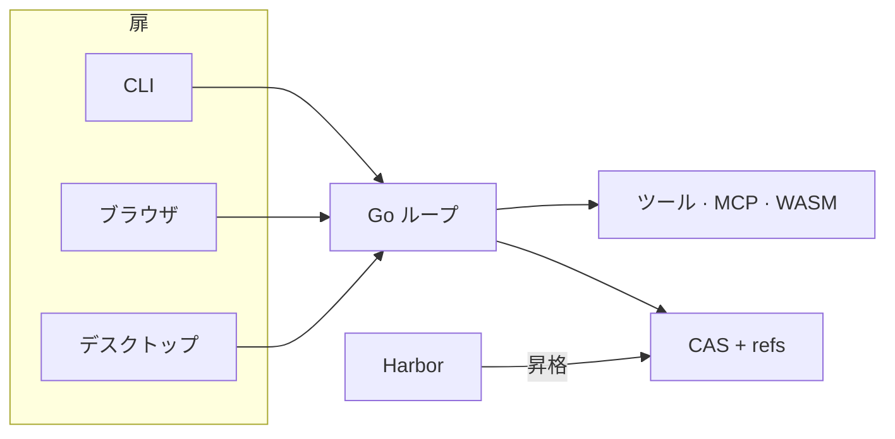

# Yoyo

<p align="center">
  
</p>

[English](README.md) · [简体中文](README.zh-CN.md) · **日本語**

[](LICENSE)
[](https://github.com/Shenchangxin/yoyo/releases)
[](https://go.dev/dl/)
[](https://shenchangxin.github.io/yoyo/)

> ローカルなエージェント・ワークステーション。ファイルは選んだフォルダに残る。ハーネスは証明してから採用する。

Yoyo はひとつの Go ループに四つの扉がある。Wails デスクトップ、このコンピュータのブラウザ、CLI、そして同じ LAN の電話。コードを書き、ハンクをレビューし、隔離ブラウザを開き、スキルパックを走らせ、専用フォルダで短い映像も扱える。プロンプトとプレイブックは進化してよい。評価器、保管庫、アップデータは進化しない。

**v0.6.0** · Apache-2.0 · Windows、macOS、Linux · OpenAI 互換のキーは自分で

[ダウンロード](https://github.com/Shenchangxin/yoyo/releases/latest) · [製品サイト](https://shenchangxin.github.io/yoyo/) · [不変条件](docs/architecture/invariants.md) · [スキルパック](docs/architecture/skill-packs.md)

---

## 一目で

| | 触るとこう |
| --- | --- |
| **Agent** | ストリーミングのターン。`@file` でファイルをピン。Plan は提案だけ。Stop はすでに書いたものを残す。 |
| **審査** | ハンクを選んで適用。隔離ブラウザ。スレッドは検索、改名、分岐。 |
| **ビデオ** | Create、Shorts、Drama、Canvas は同じクロムと専用フォルダ。コードの作業場とは混ぜない。 |
| **スキル** | `~/.yoyo/packs/` に置き、有効にするまでオフ。`@skill` でそのターンだけ領域パックを載せる。 |
| **Harness** | プロンプトはコンテンツアドレス。評価は `staging`。Evolve は `canary`。`active` を動かすのは Harbor と、そのあとあなただけ。 |

窓はループのクライアントだ。IDE ではなく、ページに第二のエージェントもない。

---

## はじめる

[Go 1.26+](https://go.dev/dl/)、Git、OpenAI 互換の API キーが要る。Node 22+ は UI をビルドするときだけ。[Wails v3](https://v3.wails.io) はネイティブ窓のときだけ。

### 1. home を蒔く

リポジトリの根で:

```bash
go run ./cmd/yoyo init
```

Windows は `%USERPROFILE%\.yoyo`、それ以外は `~/.yoyo`。コンテンツアドレスのオブジェクト、refs、密封された評価スイート、`refs/active`。場所は `YOYO_HOME` で変える。

### 2. モデルを向ける

```powershell
$env:YOYO_API_KEY = "sk-..."
```

```bash
export YOYO_API_KEY=sk-...
```

`OPENAI_API_KEY` でもよい。あとから **Settings** に貼っても同じ。既定は `gpt-4.1-mini`、`https://api.openai.com/v1`。互換の `base_url` ならどれでもよい。

### 3. 扉を選ぶ

**ブラウザ** — いちばん早く製品を見る。トレイもネイティブメニューもない。

```bash
cd frontend && npm install && npm run build && cd ..
go run ./cmd/yoyo serve --addr 127.0.0.1:3080
```

[http://127.0.0.1:3080](http://127.0.0.1:3080) を開く。

**デスクトップ** — メニュー、トレイ、通知。

```bash
go install github.com/wailsapp/wails/v3/cmd/wails3@latest
npm run dev
```

Windows では Go と Git を `PATH` に通し、Vite の 9245 を空けてから窓を開く。製品ビルドは `wails3 task build`（Windows では `bin\Yoyo.exe`）。

ループが詰まっても窓を生かしたいとき:

```powershell
$env:YOYO_ISOLATE = "1"
npm run dev
```

**CLI**

```bash
go run ./cmd/yoyo run "Write hello.txt containing hello" --workspace .
```

インストール用ビルド（Windows NSIS、macOS DMG、Linux AppImage / `.deb` / `.rpm`、Android APK、CGO なし CLI）は `v*` タグから出る。[開発](#開発) を見る。電話への入れ方は[次の節](#電話)。

---

## 電話

電話とコンピュータは同じ LAN にいる。同じ Wi-Fi か、コンピュータを電話のテザリングに入れる。[http://127.0.0.1:3080](http://127.0.0.1:3080) はコンピュータ自身でしか開かない。

Android は [Releases](https://github.com/Shenchangxin/yoyo/releases/latest) の `Yoyo-*-android.apk` を入れ、不明なアプリのインストールを許可する。コンピュータで **設定 → 詳細 → 手机** を開き、ペアリングコードを出して、電話のアプリで読み取り、コンピュータで **許可** する。新しい会話もモデルの切り替えも、そのコンピュータで実行される。コードは二分間、一度だけ。

iOS は Mac と Apple の署名が要る。この CI はインストールできる IPA を出さない。ソースは [`handheld/`](handheld/)。HarmonyOS のサービスカードは [`handheld/harmony`](handheld/harmony) にあり、DevEco Studio と flutter-oh が要る。HAP は CI から出ない。

アプリを入れないときは、同じコードを WeChat か他のスキャナで読む。電話のブラウザが許可を待つ。コンピュータで「浏览器」を許可すると、そのブラウザがデスクトップの UI になり、操作はこのコンピュータに書き戻る。許可は約 12 時間。コードは LAN の http で、自己署名の https ではない。秘密の鍵は電話へ送らない。

---

## ワークステーション

### Agent

タスクを書く。メンションは予算つきの注入で、木の丸投げではない。

```
Fix the parser in @file:internal/runtime/loop.go
Use the conventions in @folder:docs
What harness is live? @harness
Load a pack for this turn @skill:novel-to-game
```

| 操作 | 起きること |
| --- | --- |
| 送信 / Ctrl+Enter | トークンとツール呼び出しを流す |
| Stop | ターンを止める。すでに書いたものは残る |
| Plan | 提案する。書き込みと shell は閉じたまま |
| 一度 / この会話 / 常に / 拒否 | 承認はストリームに出る。デスクトップの既定は尋ねる |

USD 予算は提案ではなく、硬い停止だ。

### 審査

横のペインはキューだ。

- **Diff** — ハンク単位で適用する。ファイルがなければ復旧は大声で失敗する。リポジトリを静かに巻き戻さない。
- **ブラウザ** — ワークスペースの HTML は隔離 Chrome。スクリーンショットとクリックは再読み込みしない。同じファイルを開き直すとクリックは消える。システムブラウザへ出せる。
- **スレッド** — 検索、改名、分岐。分岐は JSONL のコピーで、`refs/active` は動かない。

### ビデオ

Create、Shorts、Drama、Canvas はクロムとフォルダを共有する。キーとアダプタは設定にある。

- **Create** — クリップを取り込む。カット机が開き、吹替と組み立てはそこに残る。
- **Shorts** — 題を選び、短い作品にする。音声、組み立て、引き渡しはその机にある。
- **Drama** — 章を貼り、話数計画を確認してから撮る。
- **Canvas** — ショットの空間。編集器は絵が読めるように素のまま。

### スキル

サードパーティのスキル木は `~/.yoyo/packs/` に入り、ワークスペースが有効にするまでオフだ。

| 種類 | 例 | いつ載るか |
| --- | --- | --- |
| 方法論 | Superpowers | ワークスペースを開いたあと、プロセス内の bootstrap。アイデンティティにはならない |
| 領域 | NovelToGame | `@skill` または `load_skill` のそのターンだけ |

Harbor の評価はパックを載せない。CLI は `yoyo pack list|install|enable|update`。詳細は [docs/architecture/skill-packs.md](docs/architecture/skill-packs.md)。

### Harness

多くのエージェントはプロンプトを長くして賢く見せる。プレイブックは空疎になり、held-in は良く見え、held-out は死に、火曜の「改善」は戻せない。

Yoyo はハーネスを、Git がソースを扱うように扱う。

| 発想 | 手に入るもの |
| --- | --- |
| コンテンツアドレス | プロンプト、スキル、プレイブック、loop プリセット、評価スイート、WASM プラグインを BLAKE3 CAS に |
| 可変なのはポインタだけ | `refs/active`、`refs/canary`、`refs/staging`、`refs/archive/*` |
| マージ前にテスト | Harbor の held-in / held-out。安全失敗は昇格しない |
| 人のゲート | loop とポリシー位相の変更は L3 確認 |
| 凍結カーネル | エージェントは Go コアを書き換えられない。スローガンではなくテスト |

オンラインの評価は **`refs/staging` だけ**。Evolve は **`refs/canary` だけ**。`--promote` を付けない限り。Harbor とあなたの checkout が `refs/active` への扉だ。

信頼できるピン（`YOYO.md`、`AGENTS.md`、`CLAUDE.md`、ACE プレイブック）は毎ターン組み直す。ツールの書き起こしは信頼できない作業記憶。溢れさせ、消し、チェックポイントする。プレイブックは要約しない。

---

## アーキテクチャ



| 層 | 対象 | 変えられる者 |
| --- | --- | --- |
| L1 | プロンプト、プレイブック、スキル | Evolve。Harbor のあと |
| L2 | 署名済み WASM | 受け入れと HighRisk の確認。未署名は `refs/active` にならない。WASI ファイルシステムはない |
| L3 | loop プリセット / ポリシー位相 | あなた。UI か CLI で |
| L4 | Go カーネル、評価器、保管庫、更新鍵 | 誰も。エージェントも evolve も |

バイナリ更新は別の経路だ。`yoyo update apply` は実行中のイメージを `.old` に改名し、staging をコピーする。ロックされた `argv[0]` を静かに上書きしない。

Harness ラボは refs の `parent` を歩き、CAS を復号する。スナップショットが何を変えたか読める。**成果物を表示**はそのチェックアウトをファイルマネージャで開く。CLI は `yoyo harness lineage`、`yoyo harness reveal`、`yoyo harness show`。

---

## コマンド

| コマンド | すること |
| --- | --- |
| `yoyo init` | home を作りハーネスを蒔く |
| `yoyo run [msg] --workspace --session` | ひとターン |
| `yoyo serve --addr [--stdio]` | HTTP UI と `/api/ws`、または stdio の JSON-RPC |
| `yoyo eval […]` | スモーク、密封、転送、安全、Terminal-Bench の一部、best-of-N |
| `yoyo evolve [--rounds] [--promote]` | セルフハーネス。既定は canary のみ |
| `yoyo harness list\|show\|lineage\|reveal\|checkout\|rollback\|diff` | ポインタ、親鎖、復号した成果物 |
| `yoyo pack list\|install\|enable\|update` | スキルパック。既定はオフ |
| `yoyo replay [session]` | JSONL の軌跡を出す |
| `yoyo update apply` | 人が `updates/yoyo.staging` を入れる |
| `yoyo version` | 製品バージョン |

```bash
go run ./cmd/yoyo eval
go run ./cmd/yoyo eval --sealed
go run ./cmd/yoyo eval --safety
go run ./cmd/yoyo evolve --rounds 4
go run ./cmd/yoyo evolve --promote
```

**ShouldPromote:** held-in と held-out は退行せず、少なくとも一方は改善し、安全失敗は止める。候補は作業ツリーではなく分離した git worktree で走る。配置とフラグは [docs/architecture/harbor.md](docs/architecture/harbor.md)。

JSON-RPC は `thread.*`、`turn.start` / `turn.interrupt`、`playbook.rate`、`workspace.apply_hunks`、`eval.*`、`evolve.run`、`harness.*`、`packs.*`。

---

## 設定

| つまみ | 場所 | 既定 |
| --- | --- | --- |
| Home | `YOYO_HOME` | `~/.yoyo` |
| API キー | `YOYO_API_KEY`、`OPENAI_API_KEY`、または Settings | — |
| モデル、URL、作業場、予算 | `config.yaml` または Settings | `gpt-4.1-mini` |
| shell の自動許可 | Settings | オフ |
| ループの隔離 | `YOYO_ISOLATE=1` | オフ |
| WASM の准入鍵 | `YOYO_WASM_PUBKEY` | 空なら署名モジュールは閉じたまま |
| 評価タスク | `YOYO_EVALS` | 同梱の `evals/` |

---

## リポジトリ

```
cmd/yoyo            CLI
main.go             Wails デスクトップ
frontend/           React + Vite
internal/runtime    ループ、ツール、コンテキスト
internal/artifact   CAS、refs、スナップショット
internal/eval       Harbor と昇格ゲート
internal/evolve     省みる、整える、提案する
internal/plugin     MCP と wazero WASM
docs/architecture   不変条件、Harbor、脅威モデル
```

---

## 開発

```bash
go test ./...
cd frontend && npm install && npm run build
```

CI は Windows で Go テスト、Ubuntu でフロントエンドのビルドと、インストールできる Android APK。`v*` タグを push すると [release.yml](.github/workflows/release.yml) がデスクトップ、CLI、`Yoyo-*-android.apk` を GitHub Release に載せる。iOS と HarmonyOS はこのパイプラインにない。

```bash
git tag v0.6.0
git push origin v0.6.0
```

macOS ビルドは ad-hoc 署名で、公証はない。Windows と Linux のパッケージは未署名。

昇格、信頼計算基盤、アップデータを触る前に[不変条件](docs/architecture/invariants.md)を読む。規則はテストだ。進化中のエージェントはそれを編集できない。

---

## Yoyo がしないこと

- VS Code を分岐する、Monaco のタブを載せる
- エージェントに Go カーネルを書き換えさせる
- 自前のモデルを訓練して、それを製品と呼ぶ
- shell の拒否リストをサンドボックスだと装う
- 実行中のバイナリを静かに差し替える
- `@` を打っただけでリポジトリをプロンプトに詰め込む

これは決定であり、未着手リストではない。

---

## コミュニティ

<p align="center">
  
</p>

WeChat グループ **yoyo ai**。画像にコードの有効期限が書いてある。入り直すと更新される。

---

## ライセンス

[Apache License 2.0](LICENSE)
