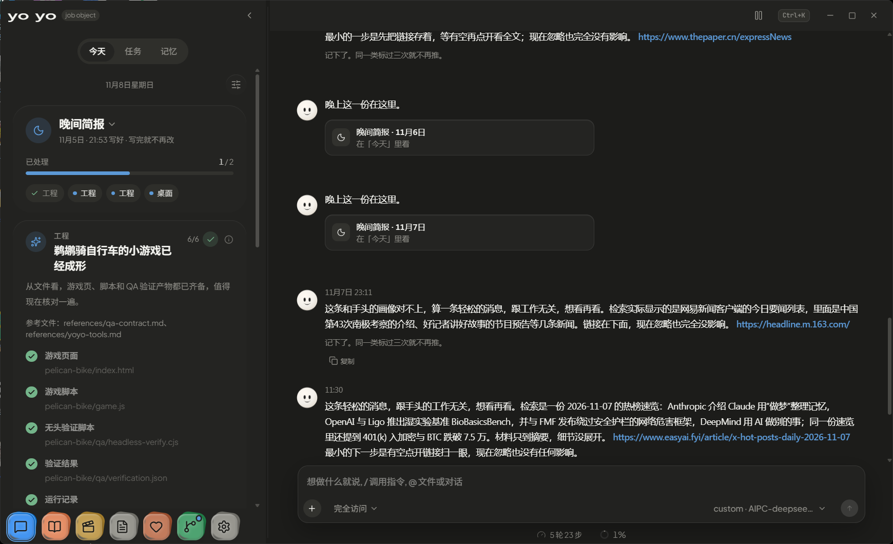
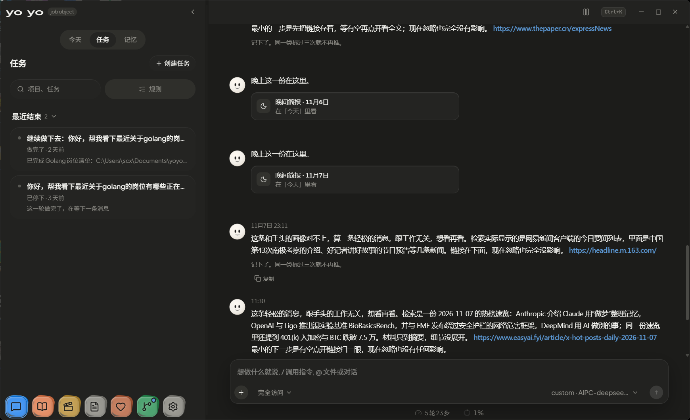
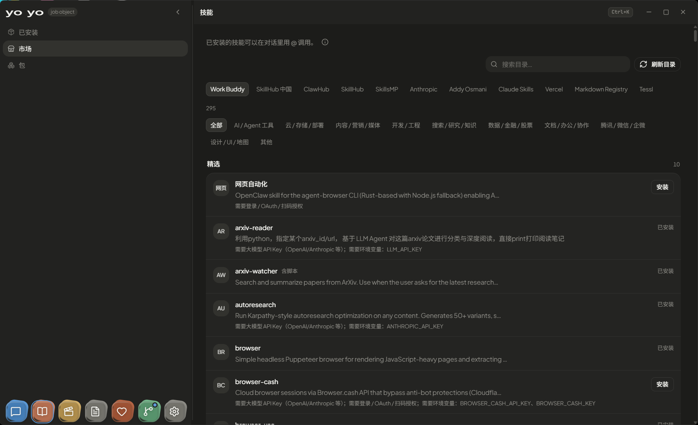
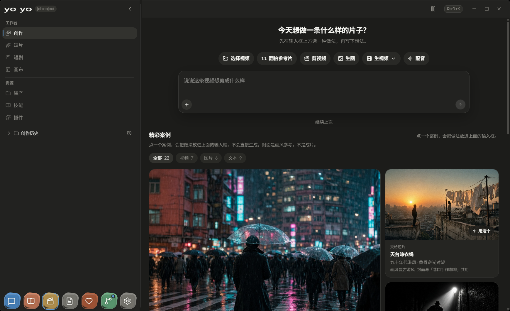
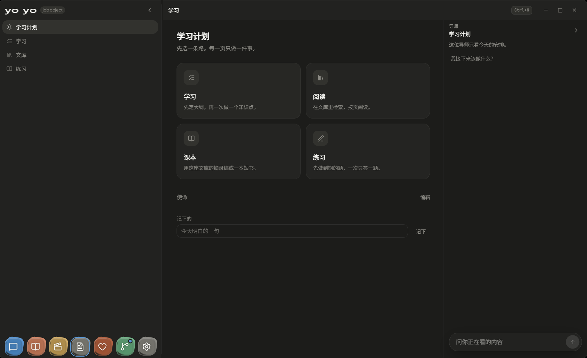
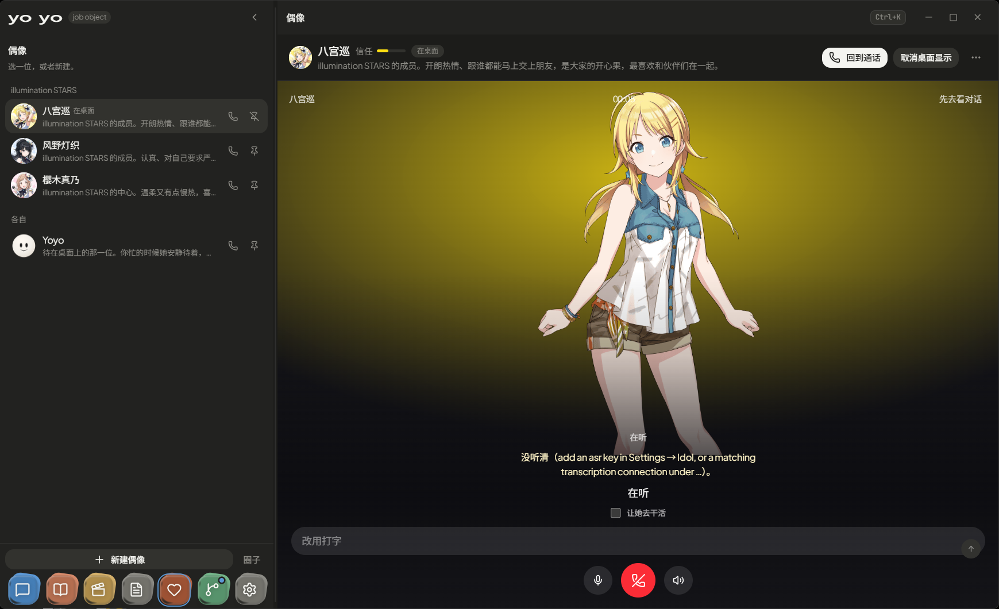
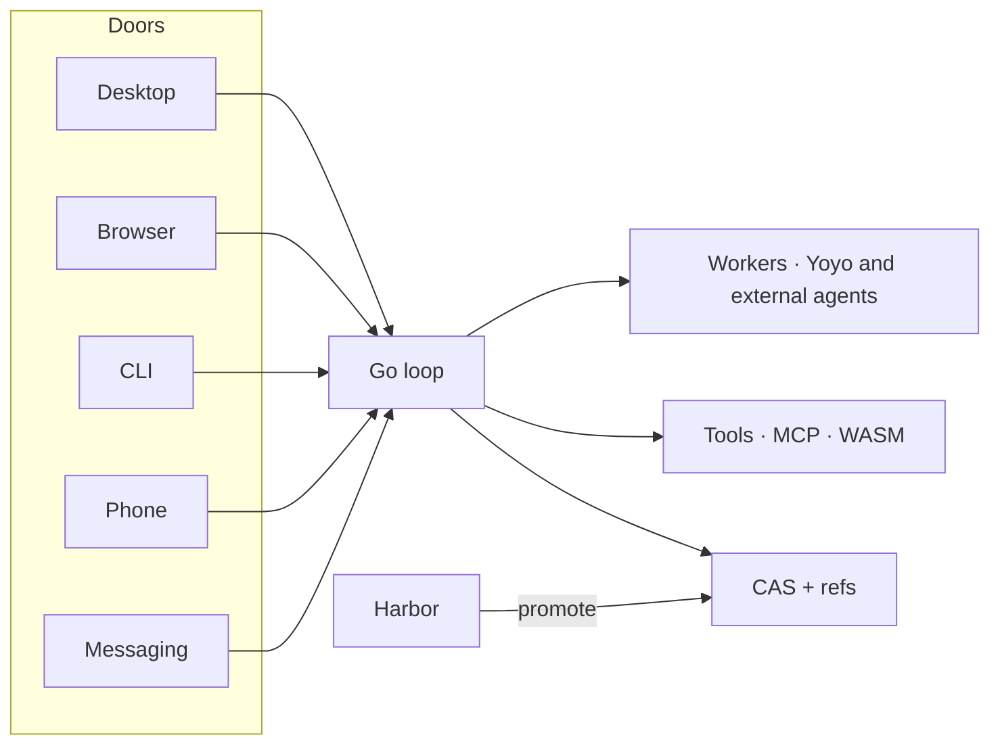

<p align="center">
  
</p>

<div align="center">

<a href="README.md">English</a> ｜
<a href="README.zh-CN.md">简体中文</a>

<br>

<div>
<a href="https://github.com/Shenchangxin/yoyo/releases/latest"></a>
<a href="https://github.com/Shenchangxin/yoyo/stargazers"></a>
<a href="LICENSE"></a>
<a href="https://go.dev/dl/"></a>
<a href="https://v3.wails.io"></a>
<a href="https://github.com/Shenchangxin/yoyo/releases/latest"></a>
<a href="https://shenchangxin.github.io/yoyo/"></a>
</div>

<br>

<a href="https://github.com/Shenchangxin/yoyo/releases/latest">Download</a> ｜
<a href="https://shenchangxin.github.io/yoyo/">Product site</a> ｜
<a href="#quick-start">Quick start</a> ｜
<a href="docs/architecture/invariants.md">Architecture</a> ｜
<a href="https://github.com/Shenchangxin/yoyo/issues">Issues</a>

</div>

<br>

Yoyo is an open-source super agent for the desktop. It is written in Go with a [Wails v3](https://v3.wails.io) window and installs on Windows, macOS, or Linux. What needs you today, the work you hand off, skills, video, study, and a companion on the desktop all live in one window. Work can go to Yoyo itself, or to local agents such as Claude Code and Codex. You bring the model. Files, chats, and keys stay on this computer.

<p align="center">
  
</p>

It is for people who want an agent on their own machine, a clear view of what it did, and a conversation that is not hosted in someone else's cloud.

> [!NOTE]
> The screenshots show the Chinese UI. The app also ships in English.

## Why Yoyo

1. 🪟 **One window for the whole day.** Today, Tasks, Skills, Video, Study, and Idol are faces of the same window, switched from the dock. The hands are always the same assistant.
2. 🧭 **Proactive, after deciding whether to speak.** Only what is due, stuck, or waiting on you shows up in Today. One brief in the morning and one in the evening, fixed once written. You set how proactive it is, and the quiet hours.
3. 🤝 **One router, many agents.** Claude Code, Codex, Gemini CLI, Qwen Code, and other local agents that speak ACP can take tickets from Yoyo once they are installed and signed in. Split the work, or give each the same job and compare.
4. 📦 **Eleven skill catalogs, one place to install.** WorkBuddy, SkillHub, ClawHub, Anthropic, Vercel, and more are searched from one market. Call what you installed with `@` in the chat. Skill packs stay off until you enable them.
5. 🎬 **From one sentence to a finished film.** Create, Shorts, Drama, and Canvas share one desk. Images, video, voice, and cutting run on your own accounts, with 90+ model plugins in the repository.
6. 🛡️ **It asks before it writes.** Writes and shell commands ask first: once, this chat, always, or deny. Changes are reviewed by hunk. Plan only proposes. A USD budget is a hard stop.
7. 🧪 **Prove it first, then switch.** Prompts and the playbook can refine themselves, but only past evaluation, and only you switch the copy in use. The kernel, the evaluator, the vault, and the updater are out of its reach.
8. 💻 **One Go loop, several doors.** Desktop, a browser on this computer, the CLI, a phone on the same LAN, and messaging platforms such as Feishu, DingTalk, WeCom, QQ, and Telegram.
9. 💯 **Free and open source, Apache-2.0.** You connect the model, keys go into a local vault, and chats are not hosted in someone else's cloud.

## A few faces of one window

The dock changes the face of this window. It does not open another app.

### Today · Tasks · Memory

Today and Tasks share a room. The day's conversation stays on the right.

<p align="center">
  
</p>

- **Today** — what is due and what needs an answer: whether to allow an action, a question, a result waiting for a look, a draft waiting to be sent. Work already underway stays in Tasks.
- **Tasks** — a task is work the conversation handed off. Finished, paused, and waiting for the next message are listed beside the chat.
- **Memory** — facts that can be checked are kept on their own. A wrong one can be forgotten.
- **Briefs** — one in the morning and one in the evening, fixed once written. Every item can show why it is there, and you can tell it to send less of that kind.
- Schedules, goals, and watches live in Settings. GitHub and Feishu can be work sources, and replies go back in place.

### Skills

<p align="center">
  
</p>

- Three tabs: **Installed**, **Market**, and **Packs**.
- The market puts 11 catalogs in one place: Work Buddy, SkillHub 中国, ClawHub, SkillHub, SkillsMP, Anthropic, Addy Osmani, Claude Skills, Vercel, Markdown Registry, and Tessl.
- An installed skill is called with `@` in the chat. It does not walk into every turn on its own.
- A skill pack is a whole skill tree, such as Superpowers or NovelToGame. Packs stay off, are enabled per workspace, and are never loaded by evaluation. Details: [docs/architecture/skill-packs.md](docs/architecture/skill-packs.md).

### Video

<p align="center">
  
</p>

| Lane | What you do there |
| --- | --- |
| **Create** | The finish desk. Pick a clip, remake a reference, cut, generate images, generate video, dub. A case only fills the input box; it does not generate |
| **Shorts** | Pick a topic, then a finished short. Voice, assembly, and handoff live on that desk |
| **Drama** | Paste a chapter, confirm the episode plan, then shoot |
| **Canvas** | A spatial board where the shots are laid out |

Shorts, Drama, and Canvas generate. **Send to finish** hands the clip to the finish desk; on the Chinese UI that button is **送到成片台**. Video has a folder and sessions of its own, apart from the code workspace. Keys and adapters live in Settings.

### Study

<p align="center">
  
</p>

Pick one path, and do one thing per page.

- **Learn** — set the outline first, then take one knowledge point at a time.
- **Read** — search the library and read by page.
- **Book** — turn excerpts from the library into a short book.
- **Practice** — due questions first, one answer at a time.
- A tutor sits beside the page. The plan, the library, and practice records stay on this machine.

### Idol

<p align="center">
  
</p>

- Pick someone, or create your own.
- Type, or call and talk. The chat model, speech, recognition, and portrait services are chosen in Settings.
- She can stay on the desktop.
- When you ask her to work, that line is handed to a normal agent session on this computer. Chat and calls stay in her own record.

## Many agents, one router

You talk to the main conversation only. The router turns a request into a ticket and hands it to a worker. The worker can be Yoyo itself, or an external agent that is online in Buddy.

| What you do | What happens |
| --- | --- |
| Mention nobody | The default agent takes it. Out of the box that is Yoyo's own worker |
| `@` one agent | The ticket goes to that agent. If it is offline, nobody is swapped in behind your back |
| `@` several agents to split the work | A task group opens, one part each, with dependencies where needed |
| Give several agents the same job | Each works in its own folder. The router compares, recommends, and you pick |

- Fourteen curated agents: Claude Code, Codex, Gemini CLI, Qwen Code, Kimi Code, CodeBuddy Code, GitHub Copilot, Qoder CLI, Cline, Grok Build, Cursor, OpenCode, goose, and Kiro CLI. Any custom command that speaks ACP v1 can be added.
- By default an agent installs into Yoyo's own folder and leaves the system alone. Keys go into the vault.
- An external agent's approvals go through the same gate as Yoyo's own worker. It can write only to its ticket folder and the task group's shared folder, and dangerous commands are still blocked.
- Workers do not talk to each other. Only the router coordinates.

Details: [docs/architecture/buddy.md](docs/architecture/buddy.md).

## Chat and review

Type a task. An `@` is a budgeted injection, and it injects only what you pointed at.

```text
Fix the parser in @file:internal/runtime/loop.go
Use the conventions in @folder:docs
What harness is live? @harness
Load a pack for this turn @skill:novel-to-game
Hand this one to @agent:claude
```

| Gesture | What happens |
| --- | --- |
| Send / Ctrl+Enter | Streams tokens and tool calls |
| Stop | Cancels the turn. Partial output stays |
| Plan | Proposes. Writes and shell stay blocked |
| Once / This chat / Always / Deny | Approvals render in the turn. Desktop defaults to ask |

Review is the side pane, and it is a queue.

- **Diff** — accept by hunk. If the files are gone, restore fails out loud. The repo is not silently rewound.
- **Browser** — isolated Chrome for workspace HTML. Screenshot and click do not reload the page. You can pop the page into the system browser.
- **Thread** — search, rename, fork. A fork copies the JSONL. It does not move `refs/active`.

## Quick Start

Install the desktop app if you want to use Yoyo now. Building from source is the developer path, at the end of this section.

| Door | What you get |
| --- | --- |
| **Desktop** | A native window, menus, a tray, and notifications. The release installer is this app |
| **Browser** | The same UI on `127.0.0.1`. No tray and no native menu |
| **CLI** | One turn, evaluation, harness refine, or skill-pack management |
| **Phone** | A client on the same LAN. Actions run on the computer. See [Phone](#phone) |

### Install the desktop app

Open [Releases](https://github.com/Shenchangxin/yoyo/releases/latest) and download the file for your system. The [product site](https://shenchangxin.github.io/yoyo/) offers the right installer for the machine you open it on.

| System | File | Install |
| --- | --- | --- |
| **Windows x64** | `Yoyo-*-windows-x64-setup.exe` | Per-user install, no admin. `windows-amd64` is the same installer |
| **macOS** | `Yoyo-*-darwin-universal.dmg` | Open the disk image and drag Yoyo into Applications |
| **Linux** | `Yoyo-*-linux-amd64.AppImage`, `.deb`, or `.rpm` | `chmod +x` the AppImage, then double-click it |
| **Android** | `Yoyo-*-android.apk` | The phone client. It works with Yoyo on a computer. See [Phone](#phone) |

> [!WARNING]
> Windows and Linux packages are unsigned. macOS builds are ad-hoc signed, not notarized. If Windows SmartScreen blocks the installer: More info → Run anyway. The source is Apache-2.0, so you can build it yourself.

Then:

1. Open Yoyo. The first launch prepares a home: `%USERPROFILE%\.yoyo` on Windows, `~/.yoyo` elsewhere. Set `YOYO_HOME` to put it somewhere else.
2. In Settings, paste an OpenAI-compatible API key. `YOYO_API_KEY` and `OPENAI_API_KEY` work too.
3. Open Today and say what it should watch first. To change code, pick a workspace folder in Settings. Code changes stay inside that folder.
4. Type a task and name a file, a skill, or an agent with `@`. Writes and shell commands ask in that turn.
5. Skills, Video, Study, and Idol open from the dock.

The default model is `gpt-4.1-mini` at `https://api.openai.com/v1`. Any compatible `base_url` is fine. Model, base URL, workspace, and budget live in `config.yaml` inside the home. Settings edits that file.

> [!NOTE]
> In-app updates read the signed release channel on ModelScope: <https://modelscope.ai/datasets/yoyo-agent/yoyo>. The download can happen on its own. Installing it is a human step, `yoyo update apply` below. The agent cannot replace the running program.

### Open it in a browser

If you want the same UI without a tray or native menus, serve it on this computer.

> [!NOTE]
> You need [Go 1.26+](https://go.dev/dl/) and Node.js 22+. This address is only for this computer. A phone on the LAN uses [Phone](#phone).

```bash
cd frontend && npm install && npm run build && cd ..
go run ./cmd/yoyo serve --addr 127.0.0.1:3080
```

Open [http://127.0.0.1:3080](http://127.0.0.1:3080).

### One turn from the CLI

If you live in a terminal and want one task against a folder:

```bash
go run ./cmd/yoyo run "Write hello.txt containing hello" --workspace .
```

The `yoyo-cli-*` archives on a Release are CGO-free CLI builds. Windows ships a `.zip`. Other systems ship a `.tar.gz`.

### Desktop window from source

For people changing the UI or the native shell. You need Go 1.26+, Git, Node.js 22+, and Wails v3. Node is only for building the UI. Wails is only for the native window.

```bash
go install github.com/wailsapp/wails/v3/cmd/wails3@v3.0.0
npm run dev
```

On Windows that command puts Go and Git on `PATH`, frees Vite port 9245, and opens the window. A production build:

```bash
wails3 task build
```

On Windows the binary is `bin\Yoyo.exe`.

> [!TIP]
> If a stuck loop should leave the window alive, set `YOYO_ISOLATE=1` before `npm run dev`.

## Phone

The phone and the computer have to be on the same LAN: the same Wi-Fi, or the computer joined to the phone's hotspot. [http://127.0.0.1:3080](http://127.0.0.1:3080) opens only on the computer. New chats, model changes, and the other phone actions run on the computer.

### Install on Android

1. Open [Releases](https://github.com/Shenchangxin/yoyo/releases/latest) and download `Yoyo-*-android.apk`. CI also uploads that file on every push and pull request. Download it from the Actions run.
2. Copy it to the phone, allow install from this source, and open it.
3. On the computer, open Yoyo, find the phone section in **Settings**, and choose **Show pairing code**.
4. Scan that code in the phone app. Back on the computer, choose **Allow**.

The code lasts two minutes and works once. After you remove the phone, show a new code. While the phone sleeps, Android keeps a connected-device notification. If a later APK is signed with a different key, uninstall the old app first.

### No app: scan with WeChat

The same code is a LAN URL. WeChat, the system camera, or another scanner can open it.

1. Show the pairing code on the computer.
2. After the scan, the phone browser stops on a page titled “等这台电脑允许”.
3. On the computer, choose **Allow** in the same list. That row is named “浏览器”.
4. The phone browser is the desktop UI. On a narrow screen, open the sidebar from the button at the top left and tap the dimmed area to close it.
5. That allowance lasts about 12 hours. Stopping the listener on the computer ends the browser session.

> [!NOTE]
> The code is plain HTTP on the LAN. WeChat will not open a self-signed certificate, so the browser does not use the phone app's TLS port. Only private addresses are accepted. Stored keys are not sent to the phone. The first of the app or the browser to use a code takes it. The other waits for a new code.

### iOS and HarmonyOS

iOS needs a Mac, Xcode, and Apple signing. This CI does not publish an installable IPA. The source is [`handheld/`](handheld/).

The HarmonyOS service-card source is [`handheld/harmony`](handheld/harmony). It needs DevEco Studio and flutter-oh. CI does not publish a HAP.

## Models and connections

You bring the chat model. Yoyo does not train one. The weights stay with the service you connect.

| Capability | How you connect | Keys |
| --- | --- | --- |
| **Chat** | OpenAI and compatible services. Default `gpt-4.1-mini` | Settings, or `YOYO_API_KEY` / `OPENAI_API_KEY` |
| **Image, video, speech, music, matting, transcription** | Connections in Settings. The catalog includes Qwen, Jimeng, Kling, Vidu, Hunyuan, Kolors, CogView, plus OpenAI, Gemini, and others | `~/.yoyo/connections`. Keys stay in the vault |
| **Search, stock, storage, workflow** | The same registry | Same |
| **External agents** | Install and sign in from Buddy. They speak ACP | The vault. Reusing one of Yoyo's keys is a switch you turn on per agent |
| **Messaging platforms** | Add a bot in Settings. Feishu, DingTalk, WeCom, QQ, Telegram, Slack, Discord, and others | The vault. Incoming chat is untrusted |
| **MCP** | Add a server in Settings | Stays on this machine |

The finish desk only sees connections that are enabled and already have a key. A different chat model gets its own way of working. A playbook tuned for one model is not reused on another.

## The lab

The harness is the material the agent works from: prompts, the playbook, skills, loop presets, and eval suites. Objects are BLAKE3 content-addressed in a CAS. The pointers are what move.

| Pointer | Who writes it | Meaning |
| --- | --- | --- |
| `refs/staging` | Helpful / Harmful, and the tidy-up after a successful turn | Draft |
| `refs/canary` | `yoyo evolve` | Candidate. `--promote` is what continues |
| `refs/active` | You, after Harbor passes | Live |
| `refs/archive/*` | Pointers you moved off | Still readable |

Promotion needs all three: held-in and held-out must not regress, at least one split must improve, and a safety failure blocks. Candidates run in a detached git worktree, not in your working tree. Layout and flags: [docs/architecture/harbor.md](docs/architecture/harbor.md).

`YOYO.md`, `AGENTS.md`, `CLAUDE.md`, and the ACE playbook are rebuilt every turn. The tool transcript is working memory: spill, clear, checkpoint. The playbook is never summarized away.

The lab walks `parent` and decodes CAS objects, so you can read what a snapshot changed. **Open files** opens that checkout in the file manager. On the Chinese UI the button is **打开文件**. CLI: `yoyo harness lineage`, `reveal`, `show`.

## Architecture



The window is a client of the loop. The phone and the messaging platforms talk to that same loop on the computer.

Who may change what:

| Layer | What | Who may change it |
| --- | --- | --- |
| **L1** | Prompts, playbook bullets, skills | Evolve, after Harbor |
| **L2** | Signed WASM tools | Admit, plus a high-risk ask. Unsigned modules never become `refs/active`. No WASI filesystem |
| **L3** | Loop preset and policy topology | You, in the UI or the CLI |
| **L4** | Go kernel, evaluator, vault, updater keys | Fixed. Not the agent. Not evolve |

An empty `YOYO_WASM_PUBKEY` keeps signed modules closed.

Binary updates are a separate channel. `yoyo update apply` renames the running program to `.old` and copies the downloaded package into place. It will not overwrite a locked running file.

| Doc | Read it for |
| --- | --- |
| [Invariants](docs/architecture/invariants.md) | Rules that stay fixed. Those rules are tests |
| [Harbor](docs/architecture/harbor.md) | Eval suites and the promotion gate |
| [Buddy](docs/architecture/buddy.md) | External agents as workers, and multi-agent task groups |
| [Proactive](docs/proactive.md) | When it speaks up, and when it stays quiet |
| [Skill packs](docs/architecture/skill-packs.md) | How methodology and domain packs load |
| [Context](docs/architecture/context.md) | What a turn injects, and what it trims |
| [Persist](docs/architecture/persist.md) | Home, connections, and the vault |
| [Threat model](docs/architecture/threat-model.md) | Trust boundaries |

## Commands

| Command | What it does |
| --- | --- |
| `yoyo init` | Prepare the home and print the live harness |
| `yoyo run [msg] --workspace --session` | One turn against a folder |
| `yoyo serve --addr [--stdio]` | Local UI and `/api/ws`, or JSON-RPC on stdio |
| `yoyo daemon` | Always-on process. Same protocol as serve. Sleep skips jobs |
| `yoyo doctor` | Print whether the vault, workspace, and harness are healthy |
| `yoyo logs` | Diagnostic log path, or the tail |
| `yoyo eval` | Run smoke, sealed, transfer, safety, or best-of-N against the live harness |
| `yoyo evolve [--rounds] [--promote]` | Self-harness cycle. Default writes `refs/canary` only |
| `yoyo harness list\|show\|lineage\|reveal\|checkout\|rollback\|diff` | Pointers, parent chain, decoded artifacts |
| `yoyo pack list\|install\|uninstall\|enable\|update` | Skill packs. Off by default |
| `yoyo session` / `replay` / `trace` | Look up a session trajectory |
| `yoyo update check` / `apply` | Verify a signed update. Installing is a human step |
| `yoyo version` | Product version |

```bash
go run ./cmd/yoyo init
go run ./cmd/yoyo eval
go run ./cmd/yoyo eval --sealed
go run ./cmd/yoyo eval --safety
go run ./cmd/yoyo evolve --rounds 4
go run ./cmd/yoyo evolve --promote
```

JSON-RPC covers `thread.*`, `turn.start` / `turn.interrupt`, `playbook.rate`, `workspace.apply_hunks`, `eval.*`, `evolve.run`, `harness.*`, `packs.*`, and `buddy.*`.

## Configuration

| Knob | Where | Default |
| --- | --- | --- |
| Home | `YOYO_HOME` | `~/.yoyo` |
| API key | `YOYO_API_KEY`, `OPENAI_API_KEY`, or Settings | empty |
| Model, base URL, workspace, budget | `config.yaml` or Settings | `gpt-4.1-mini` at `https://api.openai.com/v1` |
| Auto-allow shell | Settings | off |
| Isolate the loop from the window | `YOYO_ISOLATE=1` | off |
| WASM admit key | `YOYO_WASM_PUBKEY` | empty. Signed modules stay closed |
| Eval tasks | `YOYO_EVALS` | bundled `evals/` |
| Fetching skill packs | `YOYO_GITHUB_TOKEN` or `GITHUB_TOKEN` | empty |

## Repository

```text
cmd/yoyo              CLI
main.go               Wails desktop
frontend/             React + Vite
handheld/             Android, iOS, and the HarmonyOS service card
internal/runtime      Loop, tools, context
internal/superagent   Router, tickets, task groups
internal/buddy        Install, sign-in, and health checks for external agents
internal/artifact     CAS, refs, snapshots
internal/eval         Harbor and the promotion gate
internal/evolve       Reflect, curate, propose
internal/plugin       MCP and wazero WASM
internal/video        Create, Shorts, Drama, Canvas
internal/learn        Study plan, library, books, practice
internal/idol         Idol
internal/skillmarket  The catalogs behind the skill market
plugins/yingce        Model plugins for the canvas
skills/               Skills that ship with the app
evals/                Eval tasks
site-src/             Product site source, built into site/
docs/architecture     Invariants, Harbor, Buddy, threat model
```

## Develop

Issues and pull requests are welcome. Read the [invariants](docs/architecture/invariants.md) before touching promotion, the trusted computing base, or the updater. Those rules are tests. An evolving agent is not allowed to edit them.

```bash
go test ./...
cd frontend && npm install && npm run build
```

CI runs Go tests on Windows, builds the frontend on Ubuntu, and produces an installable Android APK. Pushing a `v*` tag runs [release.yml](.github/workflows/release.yml), which attaches the desktop packages, the CLI, and `Yoyo-*-android.apk` to the GitHub Release. iOS and HarmonyOS are not on that pipeline.

```bash
git tag vX.Y.Z
git push origin vX.Y.Z
```

Replace the version with the one you are publishing. macOS builds are ad-hoc signed, not notarized. Windows and Linux packages are unsigned.

The product site source is in [`site-src/`](site-src/). After a change lands on `master`, [pages.yml](.github/workflows/pages.yml) publishes it to GitHub Pages.

## Before you start

These are the edges of the product.

- It is a workstation on this computer. You bring the key. The conversation is not hosted in someone else's cloud.
- It does not train a model of its own. The weights stay with the service you connect.
- Skill packs stay off. Evaluation never loads them.
- The kernel, the evaluator, the vault, and the updater stay fixed.
- Isolation is something you turn on, and the app says so. A shell deny-list is not a sandbox.
- A person applies updates. The running program is not replaced on its own.
- `@` injects the file, folder, harness, skill, or agent you named.
- The phone has to be on the same LAN as the computer. The work runs on the computer.

## Community

<p align="center">
  
</p>

WeChat group **yoyo ai**. The image states how long the code stays valid. Join again to refresh it.

Bugs and requests go to [Issues](https://github.com/Shenchangxin/yoyo/issues).

## Star History

> [!TIP]
> If Yoyo helps your work, or you care where it goes next, give the project a Star.

<div align="center">

[](https://star-history.com/#Shenchangxin/yoyo&Date)

<br>

_Your day, in one window. It asks before it writes. A new way of working has to prove itself, and you are the one who switches it on._

<br>

[Apache License 2.0](LICENSE)

</div>
