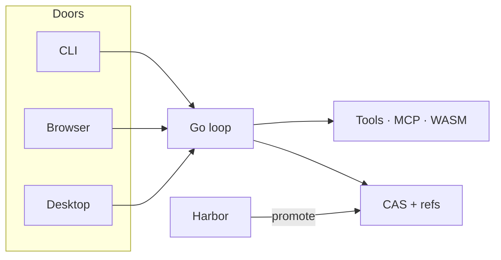

# Yoyo

<p align="center">
  
</p>

**English** · [简体中文](README.zh-CN.md) · [日本語](README.ja.md)

[](LICENSE)
[](https://github.com/Shenchangxin/yoyo/releases)
[](https://go.dev/dl/)
[](https://shenchangxin.github.io/yoyo/)

> A local agent workstation. Files stay in a folder you pick. The harness has to prove itself before you trust the new one.

Yoyo is one Go agent loop with three doors: a Wails desktop, a browser, and a CLI. It writes code, reviews hunks, opens an isolated browser, runs skill packs, and can shoot short-form video in its own folder. Prompts and playbooks may evolve. The evaluator, the vault, and the updater may not.

**v0.6.0** · Apache-2.0 · Windows, macOS, Linux · bring your own OpenAI-compatible key

[Download](https://github.com/Shenchangxin/yoyo/releases/latest) · [Product site](https://shenchangxin.github.io/yoyo/) · [Invariants](docs/architecture/invariants.md) · [Skill packs](docs/architecture/skill-packs.md)

---

## At a glance

| | What it feels like |
| --- | --- |
| **Agent** | A streaming turn. `@file` pins a file. Plan proposes. Stop keeps what already landed. |
| **Review** | Tick hunks and apply them. An isolated browser for the page the agent opened. Search, rename, fork the thread. |
| **Video** | Create, Shorts, Drama, and Canvas share one chrome and their own folder. Not mixed with the code workspace. |
| **Skills** | Packs live in `~/.yoyo/packs/` and stay off until you enable them. `@skill` loads a domain pack for one turn. |
| **Harness** | Prompts are content-addressed. Thumbs write `staging`. Evolve writes `canary`. Only Harbor, then you, can move `active`. |

The window is a client of the loop. It is not an IDE, and there is no second agent hiding in the page.

---

## Get started

You need [Go 1.26+](https://go.dev/dl/), Git, and an OpenAI-compatible API key. Node 22+ is only for building the UI. [Wails v3](https://v3.wails.io) is only for the native window.

### 1. Seed a home

From the repo root:

```bash
go run ./cmd/yoyo init
```

That creates `%USERPROFILE%\.yoyo` on Windows, or `~/.yoyo` elsewhere: content-addressed objects, refs, a sealed eval suite, and `refs/active`. Override the location with `YOYO_HOME`.

### 2. Point at a model

```powershell
$env:YOYO_API_KEY = "sk-..."
```

```bash
export YOYO_API_KEY=sk-...
```

`OPENAI_API_KEY` works too. You can paste the key later in **Settings**. The default model is `gpt-4.1-mini` at `https://api.openai.com/v1`. Any compatible `base_url` is fine.

### 3. Open a door

**Browser** — fastest look at the product. No tray, no native menu.

```bash
cd frontend && npm install && npm run build && cd ..
go run ./cmd/yoyo serve --addr 127.0.0.1:3080
```

Open [http://127.0.0.1:3080](http://127.0.0.1:3080).

**Desktop** — menus, tray, notifications.

```bash
go install github.com/wailsapp/wails/v3/cmd/wails3@latest
npm run dev
```

That command puts Go and Git on `PATH` on Windows, frees Vite port 9245, and opens the window. A production build is `wails3 task build` (`bin\Yoyo.exe` on Windows).

If you want a wedged loop to leave the window alive:

```powershell
$env:YOYO_ISOLATE = "1"
npm run dev
```

**CLI**

```bash
go run ./cmd/yoyo run "Write hello.txt containing hello" --workspace .
```

Installable builds (Windows NSIS, macOS DMG, Linux AppImage / `.deb` / `.rpm`, plus a CGO-free CLI) are published from a `v*` tag. See [Develop](#develop).

---

## The workstation

### Agent

Type a task. Mentions are budgeted injections, not a dump of the tree.

```
Fix the parser in @file:internal/runtime/loop.go
Use the conventions in @folder:docs
What harness is live? @harness
Load a pack for this turn @skill:novel-to-game
```

| Gesture | What happens |
| --- | --- |
| Send / Ctrl+Enter | Streams tokens and tool calls |
| Stop | Cancels the turn. Partial output stays |
| Plan | Proposes. Writes and shell stay blocked |
| Once / This chat / Always / Deny | Approvals render in the stream. Desktop defaults to ask |

A USD budget is a hard stop, not a suggestion.

### Review

The side pane is a queue.

- **Diff** — accept by hunk. If the files are gone, restore fails out loud. It does not silently rewind the repo.
- **Browser** — isolated Chrome for workspace HTML. Screenshot and click do not reload; opening the same file again wipes clicks. You can pop the page into the system browser.
- **Thread** — search, rename, fork. A fork copies the JSONL. It does not move `refs/active`.

### Video

Create, Shorts, Drama, and Canvas share chrome and a folder of their own. Keys and adapters live in Settings.

- **Create** — import a clip. The cut desk opens; dubbing and assembly stay there.
- **Shorts** — pick a topic, then a finished short. Voice, assemble, and handoff live on that desk.
- **Drama** — paste a chapter, confirm the episode plan, then shoot.
- **Canvas** — a spatial board for shots. The editor stays plain so the picture stays readable.

### Skills

Third-party skill trees install under `~/.yoyo/packs/` and stay off until the workspace enables them.

| Kind | Example | When it loads |
| --- | --- | --- |
| Methodology | Superpowers | A bootstrap skill, in-process, after the workspace opens. It does not become identity |
| Domain | NovelToGame | Only when you `@skill` or `load_skill` |

Harbor evals never load packs. `yoyo pack list|install|enable|update` is the CLI. Details: [docs/architecture/skill-packs.md](docs/architecture/skill-packs.md).

### Harness

Most agents get smarter by shipping a longer prompt. The playbook turns to mush, held-in tasks look great, held-out tasks die, and Tuesday’s “improvement” cannot be undone.

Yoyo treats the harness the way Git treats source.

| Idea | What you actually get |
| --- | --- |
| Content-addressed objects | BLAKE3 CAS for prompts, skills, playbooks, loop presets, eval suites, WASM plugins |
| Mutable pointers only | `refs/active`, `refs/canary`, `refs/staging`, `refs/archive/*` |
| Tests before merge | Harbor held-in / held-out. A safety failure never promotes |
| A human gate | Loop and policy topology changes need L3 confirmation |
| A frozen kernel | The agent cannot rewrite the Go core. That is a test, not a slogan |

Online thumbs write **`refs/staging` only**. Evolve writes **`refs/canary` only** unless you pass `--promote`. Harbor plus your checkout is the door to `refs/active`.

Trusted pins (`YOYO.md`, `AGENTS.md`, `CLAUDE.md`, the ACE playbook) are rebuilt every turn. The tool transcript is untrusted working memory: spill, clear, checkpoint. The playbook is never summarized away.

---

## Architecture



| Layer | What | Who may change it |
| --- | --- | --- |
| L1 | Prompts, playbook bullets, skills | Evolve, after Harbor |
| L2 | Signed WASM tools | Admit + a HighRisk ask. Unsigned modules never become `refs/active`. No WASI filesystem |
| L3 | Loop preset / policy topology | You, in the UI or the CLI |
| L4 | Go kernel, evaluator, vault, updater keys | Nobody. Not the agent. Not evolve |

Binary updates are a separate channel. `yoyo update apply` renames the running image to `.old` and copies staging into place. It will not silently overwrite a locked `argv[0]`.

The Harness lab walks `parent` from the refs and decodes CAS objects, so you can read what a snapshot changed. **Show artifacts** opens that checkout in the file manager. CLI: `yoyo harness lineage`, `yoyo harness reveal`, `yoyo harness show`.

---

## Commands

| Command | What it does |
| --- | --- |
| `yoyo init` | Create home and seed the harness |
| `yoyo run [msg] --workspace --session` | One turn |
| `yoyo serve --addr [--stdio]` | HTTP UI and `/api/ws`, or JSON-RPC on stdio |
| `yoyo eval […]` | Smoke, sealed, transfer, safety, Terminal-Bench subset, best-of-N |
| `yoyo evolve [--rounds] [--promote]` | Self-harness cycle. Default: canary only |
| `yoyo harness list\|show\|lineage\|reveal\|checkout\|rollback\|diff` | Pointers, parent chain, decoded artifacts |
| `yoyo pack list\|install\|enable\|update` | Skill packs. Off by default |
| `yoyo replay [session]` | Print a JSONL trajectory |
| `yoyo update apply` | Human install of `updates/yoyo.staging` |
| `yoyo version` | Product version |

```bash
go run ./cmd/yoyo eval
go run ./cmd/yoyo eval --sealed
go run ./cmd/yoyo eval --safety
go run ./cmd/yoyo evolve --rounds 4
go run ./cmd/yoyo evolve --promote
```

**ShouldPromote:** held-in and held-out must not regress, at least one split must improve, and any safety fail blocks. Candidates run in a detached git worktree, not in your working tree. Layout and flags: [docs/architecture/harbor.md](docs/architecture/harbor.md).

JSON-RPC covers `thread.*`, `turn.start` / `turn.interrupt`, `playbook.rate`, `workspace.apply_hunks`, `eval.*`, `evolve.run`, `harness.*`, and `packs.*`.

---

## Configuration

| Knob | Where | Default |
| --- | --- | --- |
| Home | `YOYO_HOME` | `~/.yoyo` |
| API key | `YOYO_API_KEY`, `OPENAI_API_KEY`, or Settings | — |
| Model, base URL, workspace, budget | `config.yaml` or Settings | `gpt-4.1-mini` |
| Auto-allow shell | Settings | off |
| Isolate the loop | `YOYO_ISOLATE=1` | off |
| WASM admit key | `YOYO_WASM_PUBKEY` | empty means signed modules stay closed |
| Eval tasks | `YOYO_EVALS` | bundled `evals/` |

---

## Repository

```
cmd/yoyo            CLI
main.go             Wails desktop
frontend/           React + Vite
internal/runtime    Loop, tools, context
internal/artifact   CAS, refs, snapshots
internal/eval       Harbor and the promotion gate
internal/evolve     Reflect, curate, propose
internal/plugin     MCP and wazero WASM
docs/architecture   Invariants, Harbor, threat model
```

---

## Develop

```bash
go test ./...
cd frontend && npm install && npm run build
```

CI runs Go tests on Windows and a frontend build on Ubuntu. Pushing a `v*` tag runs [release.yml](.github/workflows/release.yml):

```bash
git tag v0.6.0
git push origin v0.6.0
```

macOS builds are ad-hoc signed, not notarized. Windows and Linux packages are unsigned.

Read [invariants](docs/architecture/invariants.md) before touching promotion, the trusted computing base, or the updater. Those rules are tests. An evolving agent is not allowed to edit them.

---

## What Yoyo will not do

- Fork VS Code, or ship a Monaco tab
- Let the agent rewrite its Go kernel
- Train a custom model and call it the product
- Pretend a shell deny-list is a sandbox
- Silently replace the running binary
- Stuff the repository into the prompt because you typed `@`

Those are decisions, not a backlog.

---

## Community

<p align="center">
  
</p>

WeChat group **yoyo ai**. The image states how long the code stays valid. Join again to refresh it.

---

## License

[Apache License 2.0](LICENSE)
