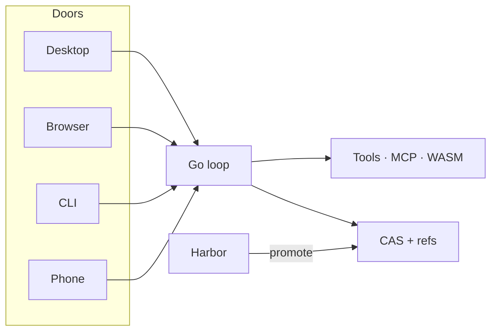

<p align="center">
  
</p>

<div align="center">

<a href="README.md">English</a> ｜
<a href="README.zh-CN.md">简体中文</a>

<br>

<div>
<a href="https://github.com/Shenchangxin/yoyo/releases/latest"></a>
<a href="https://github.com/Shenchangxin/yoyo/stargazers"></a>
<a href="LICENSE"></a>
<a href="https://go.dev/dl/"></a>
<a href="https://v3.wails.io"></a>
<a href="https://github.com/Shenchangxin/yoyo/releases/latest"></a>
<a href="https://shenchangxin.github.io/yoyo/"></a>
</div>

<br>

<a href="https://github.com/Shenchangxin/yoyo/releases/latest">Download</a> ｜
<a href="https://shenchangxin.github.io/yoyo/">Product site</a> ｜
<a href="docs/architecture/invariants.md">Architecture</a> ｜
<a href="https://github.com/Shenchangxin/yoyo/issues">Issues</a>

</div>

<br>

Yoyo is an open-source local agent workstation. The desktop app is Go with a [Wails v3](https://v3.wails.io) window. It edits code in a folder you pick, reviews each change, and can turn text into short-form video. You bring the model. Files and keys stay on this computer. Prompts and the playbook can be refined, but only after evaluation, and only you switch the live copy. The evaluator, the vault, and the updater are outside what the agent can change.

It is for people who want an agent on their own machine, a clear view of what it changed, and a conversation that is not hosted in someone else's cloud.

## Key Features

1. 💯 Free and open source, Apache-2.0. The conversation stays on this computer. Work happens in the folder you choose.
2. ✨ A streaming agent. `@file`, `@folder`, `@harness`, and `@skill` name the context. One `@` injects only what you pointed at.
3. 🛡️ Writes and shell commands ask first: once, this chat, always, or deny. Plan proposes. Stop keeps what already landed. A USD budget is a hard stop.
4. 🔍 Review diffs by hunk. An isolated browser opens workspace pages. Threads can be searched, renamed, and forked.
5. 🎬 Create, Shorts, Drama, and Canvas share one chrome. Video has its own folder, apart from the code workspace.
6. 📦 Skill packs stay off until you enable them for the current folder. Evaluation never loads them.
7. 🧪 The harness is content-addressed. Ratings and the tidy-up after a turn write a draft. Self-refine writes a candidate. You switch the live copy.
8. 💻 One Go loop, four doors: desktop, a browser on this computer, the CLI, and a phone on the same LAN.
9. 🤖 Bring an OpenAI-compatible model. Image, video, speech, and the other connections share one registry, and keys go into a local vault. MCP and signed WASM tools can be attached.

## Quick Start

Install the desktop app if you want to use Yoyo now. Building from source is the developer path, at the end of this section.

| Door | What you get |
| --- | --- |
| **Desktop** | A native window, menus, a tray, and notifications. The release installer is this app |
| **Browser** | The same UI on `127.0.0.1`. No tray and no native menu |
| **CLI** | One turn, evaluation, harness refine, or skill-pack management |
| **Phone** | A client on the same LAN. Actions run on the computer. See [Phone](#phone) |

### Install the desktop app

If you want Yoyo on Windows, macOS, or Linux and you do not want to install Go first, use a release build.

Open [Releases](https://github.com/Shenchangxin/yoyo/releases/latest) and download the file for your system:

| System | File | Install |
| --- | --- | --- |
| **Windows x64** | `Yoyo-*-windows-x64-setup.exe` | Per-user install, no admin. `windows-amd64` is the same installer |
| **macOS** | `Yoyo-*-darwin-universal.dmg` | Open the disk image and drag Yoyo into Applications |
| **Linux** | `Yoyo-*-linux-amd64.AppImage`, `.deb`, or `.rpm` | `chmod +x` the AppImage, then double-click it |

> [!WARNING]
> Windows and Linux packages are unsigned. macOS builds are ad-hoc signed, not notarized. If Windows SmartScreen blocks the installer: More info → Run anyway. The source is Apache-2.0, so you can build it yourself.

Then:

1. Open Yoyo. The first launch prepares a home: `%USERPROFILE%\.yoyo` on Windows, `~/.yoyo` elsewhere. It holds content-addressed objects, refs, and the live harness. Set `YOYO_HOME` to put it somewhere else.
2. In Settings, pick a workspace folder. Code changes stay inside that folder.
3. In Settings, paste an OpenAI-compatible API key. `YOYO_API_KEY` and `OPENAI_API_KEY` work too.
4. Type a task and pin a file with `@`. Writes and shell commands ask in that turn.

The default model is `gpt-4.1-mini` at `https://api.openai.com/v1`. Any compatible `base_url` is fine. Model, base URL, workspace, and budget live in `config.yaml` inside the home. Settings edits that file.

> [!NOTE]
> In-app updates read the signed release channel on ModelScope: <https://modelscope.ai/datasets/yoyo-agent/yoyo>. The download can happen on its own. Installing it is a human step, `yoyo update apply` below. The agent cannot replace the running program.

To prepare the home from the CLI and print the live harness:

```bash
go run ./cmd/yoyo init
```

### Open it in a browser

If you want the same UI without a tray or native menus, serve it on this computer.

> [!NOTE]
> You need [Go 1.26+](https://go.dev/dl/) and Node.js 22+. This address is only for this computer. A phone on the LAN uses [Phone](#phone).

```bash
cd frontend && npm install && npm run build && cd ..
go run ./cmd/yoyo serve --addr 127.0.0.1:3080
```

Open [http://127.0.0.1:3080](http://127.0.0.1:3080).

### One turn from the CLI

If you live in a terminal and want one task against a folder:

```bash
go run ./cmd/yoyo run "Write hello.txt containing hello" --workspace .
```

The `yoyo-cli-*` archives on a Release are CGO-free CLI builds. Windows ships a `.zip`. Other systems ship a `.tar.gz`.

### Desktop window from source

For people changing the UI or the native shell. You need Go 1.26+, Git, Node.js 22+, and Wails v3. Node is only for building the UI. Wails is only for the native window.

```bash
go install github.com/wailsapp/wails/v3/cmd/wails3@v3.0.0
npm run dev
```

On Windows that command puts Go and Git on `PATH`, frees Vite port 9245, and opens the window. A production build:

```bash
wails3 task build
```

On Windows the binary is `bin\Yoyo.exe`.

> [!TIP]
> If a stuck loop should leave the window alive, set `YOYO_ISOLATE=1` before `npm run dev`.

## Phone

The phone and the computer have to be on the same LAN: the same Wi-Fi, or the computer joined to the phone's hotspot. [http://127.0.0.1:3080](http://127.0.0.1:3080) opens only on the computer. New chats, model changes, and the other phone actions run on the computer.

### Install on Android

1. Open [Releases](https://github.com/Shenchangxin/yoyo/releases/latest) and download `Yoyo-*-android.apk`. CI also uploads that file on every push and pull request. Download it from the Actions run.
2. Copy it to the phone, allow install from this source, and open it.
3. On the computer, open Yoyo. Go to **Settings → Advanced → Handheld** and choose **Show pairing code**.
4. Scan that code in the phone app. Back on the computer, choose **Allow**.

The code lasts two minutes and works once. After you remove the phone, show a new code. While the phone sleeps, Android keeps a connected-device notification. If a later APK is signed with a different key, uninstall the old app first.

### No app: scan with WeChat

The same code is a LAN URL. WeChat, the system camera, or another scanner can open it.

1. Show the pairing code on the computer.
2. After the scan, the phone browser stops on a page titled “等这台电脑允许”.
3. On the computer, choose **Allow** in the same list. That row is named “浏览器”.
4. The phone browser is the desktop UI. On a narrow screen, open the sidebar from the button at the top left and tap the dimmed area to close it.
5. That allowance lasts about 12 hours. Stopping the listener on the computer ends the browser session.

> [!NOTE]
> The code is plain HTTP on the LAN. WeChat will not open a self-signed certificate, so the browser does not use the phone app's TLS port. Only private addresses are accepted. Stored keys are not sent to the phone. The first of the app or the browser to use a code takes it. The other waits for a new code.

### iOS and HarmonyOS

iOS needs a Mac, Xcode, and Apple signing. This CI does not publish an installable IPA. The source is [`handheld/`](handheld/).

The HarmonyOS service-card source is [`handheld/harmony`](handheld/harmony). It needs DevEco Studio and flutter-oh. CI does not publish a HAP.

## The workstation

The window is a client of the loop. Opening Settings (vault, policy, updater) hides the thread list. The agent cannot change those.

### Agent

Type a task. An `@` is a budgeted injection.

```text
Fix the parser in @file:internal/runtime/loop.go
Use the conventions in @folder:docs
What harness is live? @harness
Load a pack for this turn @skill:novel-to-game
```

| Gesture | What happens |
| --- | --- |
| Send / Ctrl+Enter | Streams tokens and tool calls |
| Stop | Cancels the turn. Partial output stays |
| Plan | Proposes. Writes and shell stay blocked |
| Once / This chat / Always / Deny | Approvals render in the turn. Desktop defaults to ask |

### Review

The side pane is a queue.

- **Diff** — accept by hunk. If the files are gone, restore fails out loud. The repo is not silently rewound.
- **Browser** — isolated Chrome for workspace HTML. Screenshot and click do not reload the page. Opening the same file again clears clicks. You can pop the page into the system browser.
- **Thread** — search, rename, fork. A fork copies the JSONL. It does not move `refs/active`.

### Video

Create, Shorts, Drama, and Canvas share one chrome and a folder of their own. Keys and adapters live in Settings. Video chats and agent chats are separate sessions.

| Lane | What you do there |
| --- | --- |
| **Create** | The finish desk. Import a clip, then cut, dub, and assemble there |
| **Shorts** | Pick a topic, then a finished short. Voice, assemble, and handoff live on that desk |
| **Drama** | Paste a chapter, confirm the episode plan, then shoot |
| **Canvas** | A spatial board for shots. The editor stays plain so the picture stays readable |

Shorts, Drama, and Canvas generate. **Send to finish** hands the clip to the existing cut. On the Chinese UI that button is **送到成片台**. The canvas timeline is a different editor.

### Skills

Third-party skill trees install under `~/.yoyo/packs/` and stay off. A workspace `.yoyo/packs.json` wins over the global `config.yaml`. Harbor never loads packs.

| Kind | Example | After you enable it |
| --- | --- | --- |
| Methodology | Superpowers | A bootstrap skill loads at session start. It does not become identity and does not rewrite the system prompt |
| Domain | NovelToGame | Loads when the catalog matches, or when you `@skill` / `load_skill`. `@skill` is the override |

The CLI is `yoyo pack list`, `install`, `uninstall`, `enable`, and `update`. On the desktop, open **Skills → Packs**. A new install applies to the current workspace. Details: [docs/architecture/skill-packs.md](docs/architecture/skill-packs.md).

### Harness

The harness is the material the agent works from: prompts, the playbook, skills, loop presets, and eval suites. Objects are BLAKE3 content-addressed in a CAS. The pointers are what move.

| Pointer | Who writes it | Meaning |
| --- | --- | --- |
| `refs/staging` | Helpful / Harmful, and the tidy-up after a successful turn | Draft |
| `refs/canary` | `yoyo evolve` | Candidate. `--promote` is what continues |
| `refs/active` | You, after Harbor passes | Live |
| `refs/archive/*` | Pointers you moved off | Still readable |

`YOYO.md`, `AGENTS.md`, `CLAUDE.md`, and the ACE playbook are rebuilt every turn. The tool transcript is working memory: spill, clear, checkpoint. The playbook is never summarized away.

Promotion needs all three: held-in and held-out must not regress, at least one split must improve, and a safety failure blocks. Candidates run in a detached git worktree, not in your working tree. Layout and flags: [docs/architecture/harbor.md](docs/architecture/harbor.md).

The Harness lab walks `parent` and decodes CAS objects, so you can read what a snapshot changed. **Open files** opens that checkout in the file manager. On the Chinese UI the button is **打开文件**. CLI: `yoyo harness lineage`, `reveal`, `show`.

### Other surfaces on the same loop

| Surface | What it is |
| --- | --- |
| **Learn / Pages** | Documents on this computer. Chat is the process. An approved page is the result. The agent cannot write straight into the pages tree |
| **Profiles** | A role and tool grants on the same loop. Harbor, sub-tasks, and video ignore them |
| **Idol** | Chat and calls on the companion window. When you ask her to work, that line is handed to a normal agent session on this machine |

## Models and connections

You bring the chat model. Yoyo does not train one. The weights stay with the service you connect.

| Capability | How you connect | Keys |
| --- | --- | --- |
| **Chat** | OpenAI and compatible services. Default `gpt-4.1-mini` | Settings, or `YOYO_API_KEY` / `OPENAI_API_KEY` |
| **Image, video, speech, music, matting, transcription** | Connections in Settings. The catalog includes Qwen, Jimeng, Kling, Vidu, Hunyuan, Kolors, CogView, plus OpenAI, Gemini, and others | `~/.yoyo/connections`. Keys stay in the vault |
| **Search, stock, storage, workflow** | The same registry | Same |
| **MCP** | Add a server in Settings | Stays on this machine |

The finish desk only sees connections that are enabled and already have a key. A different chat model gets its own way of working. A playbook tuned for one model is not reused on another.

## Architecture



The phone talks to the loop on the computer.

Who may change what:

| Layer | What | Who may change it |
| --- | --- | --- |
| **L1** | Prompts, playbook bullets, skills | Evolve, after Harbor |
| **L2** | Signed WASM tools | Admit, plus a high-risk ask. Unsigned modules never become `refs/active`. No WASI filesystem |
| **L3** | Loop preset and policy topology | You, in the UI or the CLI |
| **L4** | Go kernel, evaluator, vault, updater keys | Fixed. Not the agent. Not evolve |

An empty `YOYO_WASM_PUBKEY` keeps signed modules closed.

Binary updates are a separate channel. `yoyo update apply` renames the running program to `.old` and copies the downloaded package into place. It will not overwrite a locked running file.

| Doc | Read it for |
| --- | --- |
| [Invariants](docs/architecture/invariants.md) | Rules that stay fixed. Those rules are tests |
| [Harbor](docs/architecture/harbor.md) | Eval suites and the promotion gate |
| [Skill packs](docs/architecture/skill-packs.md) | How methodology and domain packs load |
| [Context](docs/architecture/context.md) | What a turn injects, and what it trims |
| [Persist](docs/architecture/persist.md) | Home, connections, and the vault |
| [Threat model](docs/architecture/threat-model.md) | Trust boundaries |

## Commands

| Command | What it does |
| --- | --- |
| `yoyo init` | Prepare the home and print the live harness |
| `yoyo run [msg] --workspace --session` | One turn against a folder |
| `yoyo serve --addr [--stdio]` | Local UI and `/api/ws`, or JSON-RPC on stdio |
| `yoyo daemon` | Always-on process. Same protocol as serve. Sleep skips jobs |
| `yoyo doctor` | Print whether the vault, workspace, and harness are healthy |
| `yoyo logs` | Diagnostic log path, or the tail |
| `yoyo eval` | Run smoke, sealed, transfer, safety, or best-of-N against the live harness |
| `yoyo evolve [--rounds] [--promote]` | Self-harness cycle. Default writes `refs/canary` only |
| `yoyo harness list\|show\|lineage\|reveal\|checkout\|rollback\|diff` | Pointers, parent chain, decoded artifacts |
| `yoyo pack list\|install\|uninstall\|enable\|update` | Skill packs. Off by default |
| `yoyo session` / `replay` / `trace` | Look up a session trajectory |
| `yoyo update check` / `apply` | Verify a signed update. Installing is a human step |
| `yoyo version` | Product version |

```bash
go run ./cmd/yoyo eval
go run ./cmd/yoyo eval --sealed
go run ./cmd/yoyo eval --safety
go run ./cmd/yoyo evolve --rounds 4
go run ./cmd/yoyo evolve --promote
```

JSON-RPC covers `thread.*`, `turn.start` / `turn.interrupt`, `playbook.rate`, `workspace.apply_hunks`, `eval.*`, `evolve.run`, `harness.*`, and `packs.*`.

## Configuration

| Knob | Where | Default |
| --- | --- | --- |
| Home | `YOYO_HOME` | `~/.yoyo` |
| API key | `YOYO_API_KEY`, `OPENAI_API_KEY`, or Settings | empty |
| Model, base URL, workspace, budget | `config.yaml` or Settings | `gpt-4.1-mini` at `https://api.openai.com/v1` |
| Auto-allow shell | Settings | off |
| Isolate the loop from the window | `YOYO_ISOLATE=1` | off |
| WASM admit key | `YOYO_WASM_PUBKEY` | empty. Signed modules stay closed |
| Eval tasks | `YOYO_EVALS` | bundled `evals/` |
| Fetching skill packs | `YOYO_GITHUB_TOKEN` or `GITHUB_TOKEN` | empty |

## Repository

```text
cmd/yoyo            CLI
main.go             Wails desktop
frontend/           React + Vite
handheld/           Android, iOS, and the HarmonyOS service card
internal/runtime    Loop, tools, context
internal/artifact   CAS, refs, snapshots
internal/eval       Harbor and the promotion gate
internal/evolve     Reflect, curate, propose
internal/plugin     MCP and wazero WASM
docs/architecture   Invariants, Harbor, threat model
```

## Develop

Issues and pull requests are welcome. Read the [invariants](docs/architecture/invariants.md) before touching promotion, the trusted computing base, or the updater. Those rules are tests. An evolving agent is not allowed to edit them.

```bash
go test ./...
cd frontend && npm install && npm run build
```

CI runs Go tests on Windows, builds the frontend on Ubuntu, and produces an installable Android APK. Pushing a `v*` tag runs [release.yml](.github/workflows/release.yml), which attaches the desktop packages, the CLI, and `Yoyo-*-android.apk` to the GitHub Release. iOS and HarmonyOS are not on that pipeline.

```bash
git tag v0.6.0
git push origin v0.6.0
```

Replace the version with the one you are publishing. macOS builds are ad-hoc signed, not notarized. Windows and Linux packages are unsigned.

## Before you start

These are the edges of the product.

- It is a workstation on this computer. You bring the key. The conversation is not hosted in someone else's cloud.
- It does not train a model of its own. The weights stay with the service you connect.
- Skill packs stay off. Evaluation never loads them.
- The kernel, the evaluator, the vault, and the updater stay fixed.
- Isolation is something you turn on, and the app says so. A shell deny-list is not a sandbox.
- A person applies updates. The running program is not replaced on its own.
- `@` injects the file, folder, harness, or skill you named.

## Community

<p align="center">
  
</p>

WeChat group **yoyo ai**. The image states how long the code stays valid. Join again to refresh it.

Bugs and requests go to [Issues](https://github.com/Shenchangxin/yoyo/issues).

## Star History

> [!TIP]
> If Yoyo helps your work, or you care where it goes next, give the project a Star.

<div align="center">

[](https://star-history.com/#Shenchangxin/yoyo&Date)

<br>

_Run an agent in a folder you picked. It asks before it writes. A new way of working has to prove itself, and you are the one who switches it on._

<br>

[Apache License 2.0](LICENSE)

</div>
