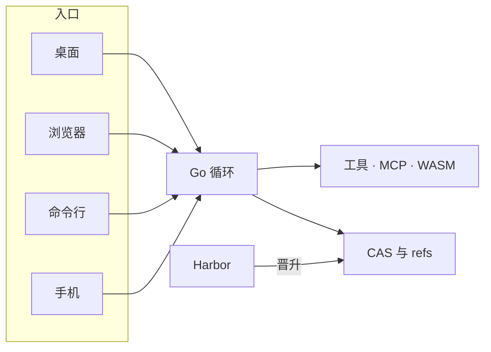

<p align="center">
  
</p>

<div align="center">

<a href="README.md">English</a> ｜
<a href="README.zh-CN.md">简体中文</a>

<br>

<div>
<a href="https://github.com/Shenchangxin/yoyo/releases/latest"></a>
<a href="https://github.com/Shenchangxin/yoyo/stargazers"></a>
<a href="LICENSE"></a>
<a href="https://go.dev/dl/"></a>
<a href="https://v3.wails.io"></a>
<a href="https://github.com/Shenchangxin/yoyo/releases/latest"></a>
<a href="https://shenchangxin.github.io/yoyo/"></a>
</div>

<br>

<a href="https://github.com/Shenchangxin/yoyo/releases/latest">下载</a> ｜
<a href="https://shenchangxin.github.io/yoyo/">产品站</a> ｜
<a href="docs/architecture/invariants.md">架构</a> ｜
<a href="https://github.com/Shenchangxin/yoyo/issues">问题反馈</a>

</div>

<br>

Yoyo 是一个开源的本地智能体工作站。桌面应用用 Go 和 [Wails v3](https://v3.wails.io) 写成。它在你指定的文件夹里改代码、按处审查改动，也能把文字拍成短片和短剧。模型由你自己接入，文件和密钥留在这台电脑上。提示词和工作手册可以打磨，但要先经过评测，再由你换成正在使用的那一份。评测器、密钥库和更新器不在它能改的范围里。

适合想在自己的电脑上跑 Agent、看清它改了什么，并且不把对话托管到别人云上的人。

## 主要功能

1. 💯 免费开源，Apache-2.0。对话留在这台电脑上，动手范围是你选的文件夹。
2. ✨ 流式 Agent。用 `@file`、`@folder`、`@harness`、`@skill` 点名上下文。一个 `@` 只会注入你点到的内容。
3. 🛡️ 写文件和跑命令之前先问你：一次、本对话、总是，或拒绝。Plan 只提议。Stop 留下已经写好的内容。美元预算到顶，这一轮就停。
4. 🔍 按 hunk 审查 diff。隔离浏览器打开工作区里的页面。会话可以搜索、改名、分叉。
5. 🎬 创作、短片、短剧、画布共用一套界面。片子有自己的目录，和代码仓库分开。
6. 📦 技能包默认关闭。你为当前文件夹打开之后才进入这一轮。评测不加载它们。
7. 🧪 Harness 按内容哈希存放。评价和整理只写草稿，自动打磨只写待晋升版本。正在使用的版本，由你切换。
8. 💻 同一条 Go 循环，四扇门：桌面、本机浏览器、命令行，以及同一局域网里的手机。
9. 🤖 自备 OpenAI 兼容模型。图像、视频、语音等连接共用一套登记，密钥进本地保管库。MCP 和签名后的 WASM 工具可以接进来。

## 快速开始

对于想马上用起来的人，直接装桌面应用。编译源码是开发者的路径，放在本节最后。

| 入口 | 你得到什么 |
| --- | --- |
| **桌面** | 原生窗口、菜单、托盘和通知。发布页上的安装包就是这个应用 |
| **浏览器** | 同一套界面，开在 `127.0.0.1`。没有托盘，也没有原生菜单 |
| **命令行** | 跑一轮、做评测、打磨 harness，或管理技能包 |
| **手机** | 同一局域网里的客户端。操作在电脑上执行。见 [手机](#手机) |

### 安装桌面应用

对于希望在 Windows、macOS 或 Linux 上直接使用、而不想先安装 Go 的用户，我们推荐发布包。

前往 [Releases](https://github.com/Shenchangxin/yoyo/releases/latest)，按系统下载：

| 系统 | 文件 | 安装 |
| --- | --- | --- |
| **Windows x64** | `Yoyo-*-windows-x64-setup.exe` | 当前用户安装，不需要管理员。`windows-amd64` 是同一份安装包 |
| **macOS** | `Yoyo-*-darwin-universal.dmg` | 打开镜像，把 Yoyo 拖进「应用程序」 |
| **Linux** | `Yoyo-*-linux-amd64.AppImage`、`.deb` 或 `.rpm` | AppImage 先 `chmod +x`，再双击 |

> [!WARNING]
> Windows 和 Linux 安装包未签名。macOS 是 ad-hoc 签名，没有公证。Windows 若被 SmartScreen 拦住：更多信息 → 仍要运行。源码是 Apache-2.0，也可以自己编译。

装好之后：

1. 打开 Yoyo。第一次运行会在本机准备 home：Windows 是 `%USERPROFILE%\.yoyo`，其他系统是 `~/.yoyo`。里面有内容寻址的对象、refs，以及当前正在使用的 harness。换位置用环境变量 `YOYO_HOME`。
2. 在设置里选一个工作文件夹。它只在这个文件夹里改代码。
3. 在设置里粘贴 OpenAI 兼容的 API Key。环境变量 `YOYO_API_KEY` 和 `OPENAI_API_KEY` 同样有效。
4. 输入任务，用 `@` 点名文件。写文件或跑命令时，问题会出现在这一轮里。

默认模型是 `gpt-4.1-mini`，地址是 `https://api.openai.com/v1`。任何兼容的 `base_url` 都可以。模型、地址、工作区和预算写在 home 里的 `config.yaml`，设置界面改的是同一份文件。

> [!NOTE]
> 应用内更新读取 ModelScope 上签名的发布信息：<https://modelscope.ai/datasets/yoyo-agent/yoyo>。下载可以自动完成。装上去是人的动作，见下面的 `yoyo update apply`。智能体不能替你替换正在运行的程序。

命令行如果要单独准备 home，并看当前 harness：

```bash
go run ./cmd/yoyo init
```

### 在浏览器里打开

对于想用同一套界面、暂时不需要托盘和原生菜单的用户，可以在本机起一个页面。

> [!NOTE]
> 需要 [Go 1.26+](https://go.dev/dl/) 和 Node.js 22+。这个地址只给这台电脑自己用，局域网里的手机请走 [手机](#手机)。

```bash
cd frontend && npm install && npm run build && cd ..
go run ./cmd/yoyo serve --addr 127.0.0.1:3080
```

打开 [http://127.0.0.1:3080](http://127.0.0.1:3080)。

### 命令行跑一轮

对于熟悉终端、只想对一个文件夹跑一轮任务的用户：

```bash
go run ./cmd/yoyo run "在当前目录写一份 hello.txt，内容是 hello" --workspace .
```

Release 里的 `yoyo-cli-*` 是不依赖 CGO 的命令行压缩包。Windows 是 `.zip`，其他系统是 `.tar.gz`。

### 从源码打开桌面窗口

对于要改界面或原生壳的开发者。需要 Go 1.26+、Git、Node.js 22+，以及 Wails v3。Node 只在构建界面时需要，Wails 只在打开原生窗口时需要。

```bash
go install github.com/wailsapp/wails/v3/cmd/wails3@v3.0.0
npm run dev
```

这条命令会在 Windows 上把 Go 和 Git 放进 `PATH`，腾出 Vite 的 9245 端口，然后打开窗口。生产构建：

```bash
wails3 task build
```

Windows 上的产物是 `bin\Yoyo.exe`。

> [!TIP]
> 希望循环卡住时窗口仍然活着，先设置 `YOYO_ISOLATE=1`，再运行 `npm run dev`。

## 手机

手机和电脑要在同一个局域网：同一张 Wi-Fi，或者让电脑加入手机热点。[http://127.0.0.1:3080](http://127.0.0.1:3080) 只有电脑自己能打开。手机上的新建对话、切换模型和其他操作，都在电脑上执行。

### 安装 Android

1. 打开 [Releases](https://github.com/Shenchangxin/yoyo/releases/latest)，下载 `Yoyo-*-android.apk`。每次推送和拉取请求的 CI 也会上传这个包，可以从 Actions 里下载。
2. 把安装包传到手机，允许「安装未知应用」，然后打开它。
3. 在电脑上打开 Yoyo，进入 **设置 → 高级 → 手机**，点 **显示配对码**。
4. 用手机 App 扫这个码。回到电脑，点 **允许**。

配对码两分钟有效，只能用一次。移除这台手机之后，要重新出示。手机休眠时，Android 会留一条已连接设备的通知。签名密钥如果换了，先卸载旧的再装新的。

### 不装 App，用微信扫

同一个配对码是一个局域网网址。微信、系统相机或其他扫码工具都能打开它。

1. 电脑上照旧出示配对码。
2. 扫码之后，手机浏览器停在「等这台电脑允许」。
3. 回到电脑，在同一张列表里点 **允许**。这一项的名字是「浏览器」。
4. 手机浏览器进入电脑上的那套界面。窄屏时，侧栏从左上角的按钮打开，点旁边的遮罩关上。
5. 这次允许大约 12 小时内有效。在电脑上停止监听之后，这次浏览器会话结束。

> [!NOTE]
> 这个码是局域网里的 HTTP。微信打不开自签名证书，所以浏览器不走手机 App 的 TLS 端口。只接受内网地址。保管库里的密钥不会发到手机上。一个码先被 App 或浏览器用掉，另一个就要等新的码。

### iOS 与鸿蒙

iOS 需要一台 Mac、Xcode 和 Apple 签名。这条 CI 不发布可以直接安装的 IPA，源码在 [`handheld/`](handheld/)。

鸿蒙服务卡片的源码在 [`handheld/harmony`](handheld/harmony)，需要 DevEco Studio 和 flutter-oh。CI 不发布 HAP。

## 工作站

窗口是这条循环的客户端。设置（保管库、策略、更新）打开时，会话列表让开。智能体改不了这些。

### 对话

直接写任务。`@` 是有预算的注入。

```text
把 @file:internal/runtime/loop.go 里的解析错误补上返回值
按 @folder:docs 里的约定来改
现在用的是哪一份 harness？ @harness
这一轮载入 @skill:novel-to-game
```

| 动作 | 结果 |
| --- | --- |
| 发送 / Ctrl+Enter | 流式输出文字和工具调用 |
| Stop | 取消这一轮。已经写出的留下 |
| Plan | 只提议。写入和 shell 保持关闭 |
| 一次 / 本对话 / 总是 / 拒绝 | 审批画在这一轮里。桌面默认是问你 |

### 审查

侧栏是待处理的队列。

- **Diff** — 按 hunk 勾选再应用。文件已经不在时，恢复会直接失败，仓库不会被悄悄倒回去。
- **浏览器** — 工作区里的 HTML 走隔离的 Chrome。截图和点击不会把页面重载掉。再次打开同一份文件会清掉点击。页面可以丢到系统浏览器。
- **会话** — 搜索、改名、分叉。分叉复制 JSONL，不会移动 `refs/active`。

### 视频

创作、短片、短剧、画布共用一套壳，目录是自己的。密钥和适配器在设置里。视频会话和写代码的会话不是同一条。

| 车道 | 你在这里做什么 |
| --- | --- |
| **创作** | 成片台。导入一条片子之后，剪辑、配音和成片留在这里 |
| **短片** | 选一个选题，再做成片。口播、合成和交接都在这张桌上 |
| **短剧** | 贴上一章，先确认分集，再拍 |
| **画布** | 镜头排在同一张空间桌面上。编辑器保持干净，画面才看得清 |

短片、短剧和画布负责生成。要进成片台时，点 **送到成片台**。画布自己的时间线和成片台不是同一个编辑器。

### 技能

第三方技能树安装到 `~/.yoyo/packs/`，默认关闭。工作区里的 `.yoyo/packs.json` 优先于全局 `config.yaml`。Harbor 评测不加载任何技能包。

| 种类 | 例子 | 启用之后 |
| --- | --- | --- |
| 方法论 | Superpowers | 会话开始时装入一份 bootstrap。它不写进身份，也不改系统提示词 |
| 领域 | NovelToGame | 按目录描述匹配后载入，或由你 `@skill` / `load_skill`。`@skill` 是覆盖 |

命令是 `yoyo pack list`、`install`、`uninstall`、`enable`、`update`。桌面入口是 **Skills → Packs**。安装之后默认作用于当前工作区。详见 [docs/architecture/skill-packs.md](docs/architecture/skill-packs.md)。

### Harness

Harness 是它干活的那一套材料：提示词、playbook、技能、循环预设和评测套件。材料用 BLAKE3 做内容寻址，放进 CAS。能改的是指针。

| 指针 | 谁写入 | 含义 |
| --- | --- | --- |
| `refs/staging` | 「有帮助 / 没帮助」，以及一轮成功之后的整理 | 草稿 |
| `refs/canary` | `yoyo evolve` | 待晋升。加上 `--promote` 才继续往下走 |
| `refs/active` | 你，在 Harbor 通过之后 | 正在使用 |
| `refs/archive/*` | 换下来的旧指针 | 可以回头看 |

`YOYO.md`、`AGENTS.md`、`CLAUDE.md` 和 ACE playbook 每一轮都会重建。工具抄本是工作记忆：外溢、清理、做检查点。playbook 不会被摘要掉。

晋升要同时满足三件事：持有集和留出集都不能退步，至少有一边变好，安全任务没有失败。候选跑在单独的 git worktree 里，不在你的工作区。布局和参数见 [docs/architecture/harbor.md](docs/architecture/harbor.md)。

Harness 实验室顺着 `parent` 读这些快照，并解码 CAS 里的对象。**打开文件** 会在文件管理器里打开那份检出。命令行是 `yoyo harness lineage`、`reveal`、`show`。

### 同一条循环上的其他表面

| 表面 | 做什么 |
| --- | --- |
| **学习 / 页面** | 这台电脑上的文档。对话是过程，确认过的页面才是结果。Agent 不能把文件直接写进页面目录 |
| **身份** | 同一条循环上的角色和工具授权。Harbor、子任务和视频不读它 |
| **偶像** | 桌宠窗口里的对话和通话。你让她干活时，那一行交给这台电脑上的普通 Agent 会话 |

## 模型与连接

对话模型你自己带。Yoyo 不训练专属模型，权重留在你接上的服务里。

| 能力 | 怎么接 | 密钥 |
| --- | --- | --- |
| **对话** | OpenAI 及兼容服务。默认 `gpt-4.1-mini` | 设置，或 `YOYO_API_KEY` / `OPENAI_API_KEY` |
| **图像、视频、语音、音乐、抠图、转写** | 设置里的连接。目录里有通义、即梦、可灵、Vidu、混元、Kolors、CogView，以及 OpenAI、Gemini 等 | `~/.yoyo/connections`，密钥进保管库 |
| **搜索、素材、存储、工作流** | 同一套登记 | 同上 |
| **MCP** | 设置里添加服务器 | 留在本机 |

创作台只看已经启用、并且已经有密钥的连接。换了对话模型，就换一套对应的干活方式。为这个模型调好的手册，不会套到另一个模型上。

## 架构



手机连的是电脑上的这一条循环。

谁可以改什么：

| 层级 | 内容 | 谁能改 |
| --- | --- | --- |
| **L1** | 提示词、playbook 条目、技能 | Evolve，且必须过 Harbor |
| **L2** | 签名的 WASM 工具 | 准入，外加一次高风险询问。未签名的进不了 `refs/active`。没有 WASI 文件系统 |
| **L3** | 循环预设和策略拓扑 | 你，在界面或命令行上 |
| **L4** | Go 内核、评测器、密钥库、更新密钥 | 固定。智能体不行，evolve 也不行 |

`YOYO_WASM_PUBKEY` 为空时，签名模块保持关闭。

二进制更新是另一条通道。`yoyo update apply` 把正在运行的程序改名为 `.old`，再把已经下载的包放进去。文件锁着的时候，它不会覆盖正在运行的那个文件。

| 文档 | 读什么 |
| --- | --- |
| [不变量](docs/architecture/invariants.md) | 不能改的规则。这些规则是测试 |
| [Harbor](docs/architecture/harbor.md) | 评测套件和晋升门 |
| [技能包](docs/architecture/skill-packs.md) | 方法论包和领域包怎么载入 |
| [上下文](docs/architecture/context.md) | 一轮里什么会被注入、什么会被裁掉 |
| [持久化](docs/architecture/persist.md) | home、连接和保管库 |
| [威胁模型](docs/architecture/threat-model.md) | 信任边界 |

## 命令

| 命令 | 作用 |
| --- | --- |
| `yoyo init` | 准备 home，并打印当前 harness |
| `yoyo run [msg] --workspace --session` | 对一个文件夹跑一轮 |
| `yoyo serve --addr [--stdio]` | 本机页面和 `/api/ws`，或 stdio 上的 JSON-RPC |
| `yoyo daemon` | 常驻进程，协议与 serve 相同。休眠时跳过任务 |
| `yoyo doctor` | 打印保管库、工作区和 harness 是否健康 |
| `yoyo logs` | 诊断日志的路径，或尾部内容 |
| `yoyo eval` | 用当前 harness 跑冒烟、密封套件、迁移、安全或 best-of-N |
| `yoyo evolve [--rounds] [--promote]` | 自我打磨。默认只写 `refs/canary` |
| `yoyo harness list\|show\|lineage\|reveal\|checkout\|rollback\|diff` | 指针、父子链、解码后的构件 |
| `yoyo pack list\|install\|uninstall\|enable\|update` | 技能包。默认关闭 |
| `yoyo session` / `replay` / `trace` | 按会话查看轨迹 |
| `yoyo update check` / `apply` | 核对签名更新。安装由人执行 |
| `yoyo version` | 版本号 |

```bash
go run ./cmd/yoyo eval
go run ./cmd/yoyo eval --sealed
go run ./cmd/yoyo eval --safety
go run ./cmd/yoyo evolve --rounds 4
go run ./cmd/yoyo evolve --promote
```

JSON-RPC 覆盖 `thread.*`、`turn.start` / `turn.interrupt`、`playbook.rate`、`workspace.apply_hunks`、`eval.*`、`evolve.run`、`harness.*` 和 `packs.*`。

## 配置

| 配置项 | 位置 | 默认 |
| --- | --- | --- |
| Home | `YOYO_HOME` | `~/.yoyo` |
| API Key | `YOYO_API_KEY`、`OPENAI_API_KEY`，或设置 | 空 |
| 模型、地址、工作区、预算 | `config.yaml` 或设置 | `gpt-4.1-mini`，`https://api.openai.com/v1` |
| 自动允许 shell | 设置 | 关闭 |
| 循环与窗口隔离 | `YOYO_ISOLATE=1` | 关闭 |
| WASM 准入公钥 | `YOYO_WASM_PUBKEY` | 空。签名模块保持关闭 |
| 评测任务 | `YOYO_EVALS` | 仓库里的 `evals/` |
| 拉取技能包 | `YOYO_GITHUB_TOKEN` 或 `GITHUB_TOKEN` | 空 |

## 仓库

```text
cmd/yoyo            命令行
main.go             Wails 桌面
frontend/           React + Vite
handheld/           Android、iOS，以及鸿蒙服务卡片
internal/runtime    循环、工具、上下文
internal/artifact   CAS、refs、快照
internal/eval       Harbor 和晋升门
internal/evolve     反思、整理、提议
internal/plugin     MCP 和 wazero WASM
docs/architecture   不变量、Harbor、威胁模型
```

## 开发

欢迎 Issue 和 Pull Request。改晋升、可信计算基或更新器之前，先读 [不变量](docs/architecture/invariants.md)。这些规则是测试。进化中的智能体不能改它们。

```bash
go test ./...
cd frontend && npm install && npm run build
```

CI 在 Windows 上跑 Go 测试，在 Ubuntu 上构建前端，并打出可安装的 Android APK。推送 `v*` 标签会跑 [release.yml](.github/workflows/release.yml)，把桌面包、CLI 和 `Yoyo-*-android.apk` 挂到 GitHub Release。iOS 和鸿蒙不在这条流水线里。

```bash
git tag v0.6.0
git push origin v0.6.0
```

把版本号换成你要发布的版本。macOS 构建是 ad-hoc 签名，没有公证。Windows 和 Linux 包未签名。

## 开始之前

这几件事是产品边界。

- 它是这台电脑上的工作站。密钥自己准备，对话不托管到别人的云上。
- 它不训练专属模型。权重留在你接上的服务里。
- 技能包默认关闭。评测不加载它们。
- 内核、评测器、密钥库和更新器保持冻结。
- 隔离是你打开的选项，并如实报告。一份 shell 拒绝名单不是沙箱。
- 更新由人执行。正在运行的程序不会被悄悄换掉。
- `@` 只注入你点名的文件、目录、harness 或技能。

## 社区

<p align="center">
  
</p>

微信群 **yoyo ai 交流群**。图上写着二维码的有效期，重新进群会刷新。

问题请开 [Issue](https://github.com/Shenchangxin/yoyo/issues)。

## Star History

> [!TIP]
> 如果 Yoyo 对你的工作有帮助，或者你关心它接下来怎么走，请给项目一个 Star。

<div align="center">

[](https://star-history.com/#Shenchangxin/yoyo&Date)

<br>

_在你选的文件夹里，跑一轮智能体。写之前先问你。新的干活方式，先证明，再由你换上。_

<br>

[Apache License 2.0](LICENSE)

</div>
