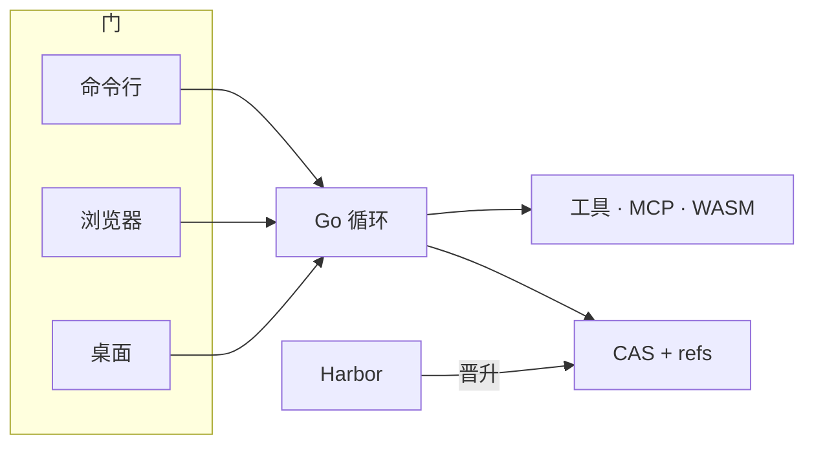

# Yoyo

<p align="center">
  
</p>

[English](README.md) · **简体中文** · [日本語](README.ja.md)

[](LICENSE)
[](https://github.com/Shenchangxin/yoyo/releases)
[](https://go.dev/dl/)
[](https://shenchangxin.github.io/yoyo/)

> 一台本地的智能体工作站。文件留在你指定的文件夹里。新 harness 没证明自己之前，不会成为你信任的那一份。

Yoyo 是同一条 Go 循环的四扇门：Wails 桌面、本机浏览器、命令行，以及同一局域网里的手机。它写代码、按 hunk 审查、开一个隔离浏览器、跑技能包，也可以在自己的目录里做短视频。提示词和 playbook 可以进化。评测器、密钥库、更新器不行。

**v0.6.0** · Apache-2.0 · Windows、macOS、Linux · 自备 OpenAI 兼容的 Key

[下载](https://github.com/Shenchangxin/yoyo/releases/latest) · [产品主页](https://shenchangxin.github.io/yoyo/) · [架构不变量](docs/architecture/invariants.md) · [Skill Pack](docs/architecture/skill-packs.md)

---

## 一眼看完

| | 用起来是什么 |
| --- | --- |
| **Agent** | 一轮流式对话。`@file` 钉一份文件。Plan 只提议。Stop 留下已经写好的东西。 |
| **审查** | 勾选 hunk 再应用。隔离浏览器打开 Agent 看过的页面。会话可搜索、改名、分叉。 |
| **视频** | 创作、短片、短剧、画布共用一套壳，目录是自己的。不和写代码的工作区搅在一起。 |
| **技能** | 包装在 `~/.yoyo/packs/`，默认关闭。`@skill` 才把领域包载进这一轮。 |
| **Harness** | 提示词按内容寻址。点赞只写 `staging`。Evolve 只写 `canary`。只有 Harbor，然后是你，才能移动 `active`。 |

窗口是这条循环的客户端。它不是 IDE，页面里也没有第二套智能体。

---

## 开始

需要 [Go 1.26+](https://go.dev/dl/)、Git，以及一个 OpenAI 兼容的 API Key。只有构建界面才需要 Node 22+。只有原生窗口才需要 [Wails v3](https://v3.wails.io)。

### 1. 种下 home

在仓库根目录：

```bash
go run ./cmd/yoyo init
```

Windows 写到 `%USERPROFILE%\.yoyo`，其他系统是 `~/.yoyo`：内容寻址对象、refs、一份密封评测套件，以及 `refs/active`。位置用 `YOYO_HOME` 改。

### 2. 接上模型

```powershell
$env:YOYO_API_KEY = "sk-..."
```

```bash
export YOYO_API_KEY=sk-...
```

`OPENAI_API_KEY` 也可以。稍后在 **Settings** 里粘贴同样有效。默认模型是 `gpt-4.1-mini`，地址 `https://api.openai.com/v1`。任何兼容的 `base_url` 都行。

### 3. 选一扇门

**浏览器** — 最快看到产品。没有托盘，没有原生菜单。

```bash
cd frontend && npm install && npm run build && cd ..
go run ./cmd/yoyo serve --addr 127.0.0.1:3080
```

打开 [http://127.0.0.1:3080](http://127.0.0.1:3080)。

**桌面** — 菜单、托盘、通知。

```bash
go install github.com/wailsapp/wails/v3/cmd/wails3@latest
npm run dev
```

这条命令会在 Windows 上把 Go 和 Git 放进 `PATH`，腾出 Vite 的 9245 端口，然后打开窗口。生产构建是 `wails3 task build`（Windows 上是 `bin\Yoyo.exe`）。

如果希望循环卡住时窗口仍然活着：

```powershell
$env:YOYO_ISOLATE = "1"
npm run dev
```

**命令行**

```bash
go run ./cmd/yoyo run "Write hello.txt containing hello" --workspace .
```

可安装包（Windows NSIS、macOS DMG、Linux AppImage / `.deb` / `.rpm`，Android APK，以及不依赖 CGO 的 CLI）由 `v*` 标签发布。见[开发](#开发)。手机的安装和微信扫码在[下一节](#手机)。

---

## 手机

手机和电脑要在同一个局域网：同一张 Wi-Fi，或者让电脑加入手机热点。电脑上的 [http://127.0.0.1:3080](http://127.0.0.1:3080) 只有这台电脑自己能打开。

### 安装 Android

1. 打开 [Releases](https://github.com/Shenchangxin/yoyo/releases/latest)，下载 `Yoyo-*-android.apk`。每次推送和拉取请求的 CI 也会上传这个包，可以从 Actions 里下载。
2. 把安装包传到手机。允许「安装未知应用」，然后打开它。
3. 打开电脑上的 Yoyo。进入 **设置 → 高级 → 手机**，点 **显示配对码**。
4. 在手机 App 里扫这个码。回到电脑，点 **允许**。
5. 之后可以新建对话、切换模型，以及电脑上能做的其他操作。这些操作在电脑上执行。

配对码两分钟有效，只能用一次。收回这台手机之后，要重新出示。手机休眠时，Android 会留一条已连接设备的通知。发布用的签名如果换了，先卸载旧的再装新的。

iOS 需要一台 Mac、Xcode 和 Apple 签名，这个 CI 打不出可以直接安装的 IPA。源码在 [`handheld/`](handheld/)。鸿蒙服务卡片的源码在 [`handheld/harmony`](handheld/harmony)，需要 DevEco Studio 和 flutter-oh。CI 不发布 HAP。

### 不装 App，用微信扫

同一个配对码是一个局域网网址。微信、系统相机或其他扫码工具都能打开它。

1. 电脑上照旧出示配对码。
2. 用微信或其他扫码工具扫它。手机浏览器停在「等这台电脑允许」。
3. 回到电脑，在同一张列表里点 **允许**。这一项的名字是「浏览器」。
4. 手机浏览器进入电脑上的那套界面。窄屏时，侧栏从左上角的按钮打开，点旁边的遮罩关上。新建对话、切换模型和其他操作都写回这台电脑。
5. 这次允许大约 12 小时内有效。在电脑上停止监听之后，这次浏览器会话结束。

这个码是局域网里的 http。微信打不开自签名证书，所以没有把浏览器塞进原来的加密端口。只接受内网地址。存着的密钥不会发到手机上。一个码先被 App 或浏览器用掉，另一个就要等新的码。

---

## 工作站

### Agent

直接写任务。`@` 是有预算的注入，不会把目录树塞进提示词。

```
Fix the parser in @file:internal/runtime/loop.go
Use the conventions in @folder:docs
What harness is live? @harness
Load a pack for this turn @skill:novel-to-game
```

| 动作 | 结果 |
| --- | --- |
| 发送 / Ctrl+Enter | 流式输出文字和工具调用 |
| Stop | 取消这一轮。已经写出的留下 |
| Plan | 只提议。写入和 shell 保持关闭 |
| 一次 / 本会话 / 永远 / 拒绝 | 审批画在对话里。桌面默认是问你 |

美元预算是硬停止，不是提醒。

### 审查

侧栏是队列。

- **Diff** — 按 hunk 接受。文件已经不在，恢复会大声失败，不会偷偷把仓库倒回去。
- **浏览器** — 工作区 HTML 走隔离 Chrome。截图和点击不会重载；再次打开同一份文件会清掉点击。页面可以丢到系统浏览器。
- **会话** — 搜索、改名、分叉。分叉复制 JSONL，不会移动 `refs/active`。

### 视频

创作、短片、短剧、画布共用一套壳，目录也是自己的。Key 和适配器在设置里。

- **创作** — 导入一条片子。剪辑台打开后，配音和成片留在那里。
- **短片** — 选一个选题，再做成片。配音、合成、交接都在这张桌上。
- **短剧** — 贴一章，先确认分集计划，再拍。
- **画布** — 镜头的空间工作区。编辑器保持干净，画面才看得清。

### 技能

第三方技能树安装到 `~/.yoyo/packs/`，工作区打开之前一直关闭。

| 种类 | 例子 | 何时载入 |
| --- | --- | --- |
| 方法论 | Superpowers | 工作区打开后，在进程内预载一份 bootstrap。它不会变成身份 |
| 领域 | NovelToGame | 只有 `@skill` 或 `load_skill` 的那一轮 |

Harbor 评测不加载技能包。命令是 `yoyo pack list|install|enable|update`。详见 [docs/architecture/skill-packs.md](docs/architecture/skill-packs.md)。

### Harness

多数智能体靠把提示词写得更长来变聪明。playbook 被改成空话，训练集看起来很好，留出集崩掉，周二那次「优化」撤不回去。

Yoyo 对待 harness，就像 Git 对待源码。

| 想法 | 你实际得到的 |
| --- | --- |
| 内容寻址 | BLAKE3 CAS 存放 prompt、技能、playbook、loop 预设、评测套件、WASM 插件 |
| 只有指针可变 | `refs/active`、`refs/canary`、`refs/staging`、`refs/archive/*` |
| 合并前先测 | Harbor 的持有集 / 留出集。安全任务失败永远不能晋升 |
| 人闸 | 改 loop 或策略拓扑必须经过 L3 确认 |
| 冻结内核 | 智能体不能改写 Go 核心。这是测试，不是口号 |

在线点赞只写 **`refs/staging`**。Evolve 只写 **`refs/canary`**，除非你加上 `--promote`。Harbor 加上你的 checkout，才是通往 `refs/active` 的门。

受信任的钉子（`YOYO.md`、`AGENTS.md`、`CLAUDE.md`、ACE playbook）每一轮都会重建。工具抄本是不可信的工作记忆：外溢、清理、做检查点。playbook 不会被摘要掉。

---

## 架构



| 层级 | 内容 | 谁能改 |
| --- | --- | --- |
| L1 | 提示词、playbook 条目、技能 | Evolve，且必须过 Harbor |
| L2 | 签名的 WASM 工具 | 准入 + HighRisk 询问。未签名的进不了 `refs/active`。没有 WASI 文件系统 |
| L3 | Loop 预设 / 策略拓扑 | 你，在界面或命令行上 |
| L4 | Go 内核、评测器、密钥库、更新密钥 | 谁都不行。智能体不行，evolve 也不行 |

二进制更新是另一条通道。`yoyo update apply` 把正在运行的镜像改名为 `.old`，再把 staging 拷进去。它不会在文件锁着的时候偷偷覆盖 `argv[0]`。

Harness 实验室顺着 `parent` 走 refs，并解码 CAS 对象，所以你能读到一个快照改了什么。**显示构件**会在文件管理器里打开那份检出。命令行：`yoyo harness lineage`、`yoyo harness reveal`、`yoyo harness show`。

---

## 命令

| 命令 | 做什么 |
| --- | --- |
| `yoyo init` | 创建 home 并种下 harness |
| `yoyo run [msg] --workspace --session` | 跑一轮 |
| `yoyo serve --addr [--stdio]` | HTTP 界面和 `/api/ws`，或 stdio 上的 JSON-RPC |
| `yoyo eval […]` | 冒烟、密封套件、迁移、安全、Terminal-Bench 子集、best-of-N |
| `yoyo evolve [--rounds] [--promote]` | 自我打磨。默认只写 canary |
| `yoyo harness list\|show\|lineage\|reveal\|checkout\|rollback\|diff` | 指针、父子链、解码后的构件 |
| `yoyo pack list\|install\|enable\|update` | 技能包。默认关闭 |
| `yoyo replay [session]` | 打印一条 JSONL 轨迹 |
| `yoyo update apply` | 由人安装 `updates/yoyo.staging` |
| `yoyo version` | 产品版本 |

```bash
go run ./cmd/yoyo eval
go run ./cmd/yoyo eval --sealed
go run ./cmd/yoyo eval --safety
go run ./cmd/yoyo evolve --rounds 4
go run ./cmd/yoyo evolve --promote
```

**ShouldPromote：** 持有集和留出集都不能退步，至少有一边要变好，任何安全失败都会挡住晋升。候选跑在分离的 git worktree 里，不在你的工作区。布局和参数见 [docs/architecture/harbor.md](docs/architecture/harbor.md)。

JSON-RPC 覆盖 `thread.*`、`turn.start` / `turn.interrupt`、`playbook.rate`、`workspace.apply_hunks`、`eval.*`、`evolve.run`、`harness.*`、`packs.*`。

---

## 配置

| 旋钮 | 在哪 | 默认 |
| --- | --- | --- |
| Home | `YOYO_HOME` | `~/.yoyo` |
| API Key | `YOYO_API_KEY`、`OPENAI_API_KEY`，或 Settings | — |
| 模型、地址、工作区、预算 | `config.yaml` 或 Settings | `gpt-4.1-mini` |
| 自动允许 shell | Settings | 关闭 |
| 把循环隔离开 | `YOYO_ISOLATE=1` | 关闭 |
| WASM 准入公钥 | `YOYO_WASM_PUBKEY` | 空表示签名模块保持关闭 |
| 评测任务 | `YOYO_EVALS` | 仓库里的 `evals/` |

---

## 仓库

```
cmd/yoyo            命令行
main.go             Wails 桌面
frontend/           React + Vite
internal/runtime    循环、工具、上下文
internal/artifact   CAS、refs、快照
internal/eval       Harbor 和晋升门
internal/evolve     反思、整理、提议
internal/plugin     MCP 和 wazero WASM
docs/architecture   不变量、Harbor、威胁模型
```

---

## 开发

```bash
go test ./...
cd frontend && npm install && npm run build
```

CI 在 Windows 上跑 Go 测试，在 Ubuntu 上构建前端，并打出可安装的 Android APK。推送 `v*` 标签会跑 [release.yml](.github/workflows/release.yml)，把桌面包、CLI 和 `Yoyo-*-android.apk` 挂到 GitHub Release。iOS 和鸿蒙不在这条流水线里。

```bash
git tag v0.6.0
git push origin v0.6.0
```

macOS 构建是 ad-hoc 签名，没有公证。Windows 和 Linux 包未签名。

改晋升、可信计算基或更新器之前，先读[不变量](docs/architecture/invariants.md)。这些规则是测试。进化中的智能体不允许改它们。

---

## Yoyo 不会做的事

- 派生 VS Code，或塞进一个 Monaco 标签页
- 让智能体改写自己的 Go 内核
- 训练一个自有模型，然后把它叫做产品
- 把一份 shell 拒绝名单说成沙箱
- 悄悄替换正在运行的二进制
- 因为你打了一个 `@`，就把整个仓库塞进提示词

这些是决定，不是待办。

---

## 交流群

<p align="center">
  
</p>

微信群 **yoyo ai 交流群**。图上写着二维码的有效期，重新进群会刷新。

---

## 许可证

[Apache License 2.0](LICENSE)
