# Yoyo UI/UX 优化方案：主动式个人 Agent 的界面

审阅：2026-11-06。代码基线是 `d0d8649`（0.8.2）。主动式的功能线（`desk-feed`、`work-model`、`initiative/gate`）正在并行修改，本方案只规定这些功能**放在哪、长什么样、怎么打断人**，不改它们的判断逻辑。

配套材料：

- 界面草图：[uiux/mockups.html](uiux/mockups.html)。在仓库里用浏览器打开，底部可以切换「今天 / 为什么 / 任务 / 任务会话 / 记忆 / 设置」和深浅色。
- 现状截图：用 HEAD 的前端和端到端测试的 mock 渲染（`VITE_E2E=1`），数据是示例，不是本机数据。
- 产品对照依据：[proactive.md](proactive.md)、[research/products/](research/products/README.md)，以及第 2 节列出的官方页面。

---

## 0. 结论

1. **问题在骨架，不在单个组件。** 现在把「今天 / 任务 / 记忆」塞进了左侧导航栏，导航挪到了底部七色玻璃坞，审查改动又占回左栏。主要内容、导航和检查器挤在同一条栏里。
2. **换成 Today AI 的布局：对话在中间，个人面板在右边。** 左侧是一条 64px 的导航轨。中间是主对话。右侧 400px 的个人面板放「今天 / 任务 / 记忆」。审查、文件、浏览器也在右侧打开。其他模块沿用自己的左侧模块栏。
3. **「需要你」只留一处。** 现在有 6 个地方在报"要你处理"：今天里的待接受、任务状态、顶栏铃铛、对话里的审批、桌宠气泡、设置→个人→发送审阅。合成右侧「今天」顶部的一张队列。其余位置只显示徽标。
4. **任务按三级打开：状态 → 预览 → 聚焦。** 列表里一行一句状态。点开后在右侧面板里是一段完整的任务会话，可以接着说。需要长时间配合时，再展开到中间。同一时间屏幕上只有一个主输入框。
5. **一套视觉语言。** 现在至少有五种风格并存，前端功能代码里有 18 种字号、12 种随手写的圆角。收成 7 级字号、6 级圆角、5 个状态色。已经接入的 React Bits 组件全部保留，改的是触发条件：动效只表达状态。
6. **设置从 11 页 47 节收到 8 页 26 节。** 记忆、定时任务、目标、监视、发送审阅从设置搬回它们的表面。新增「主动与通知」一页，把简报时间、主动程度、安静时段、通知方式和自动接单放在一起。
7. **分五期落地，每期都能单独发版。** 第一期只动骨架和令牌，不碰主动式的判断逻辑，可以和正在进行的功能线并行。

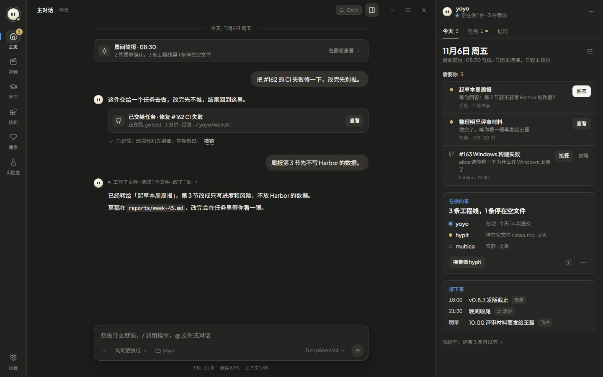

---

## 1. 现状

### 1.1 现在的骨架

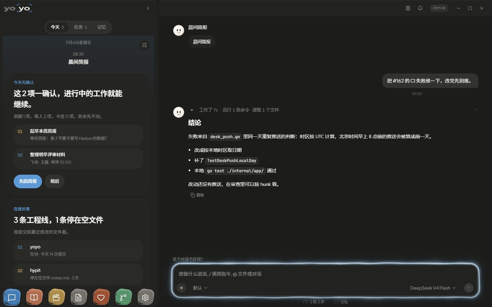

```
┌──── 左栏 32%–42% ─────┐┌──────────── 舞台 ────────────┐
│ yo[yo] 字标            ││ 顶栏：暂停 · 铃铛 · Ctrl K    │
│ [今天 2|任务 1|记忆]   ││                              │
│ 晨间简报卡片（22px 标题）││ 主对话                        │
│ 待接受的来信           ││                              │
│ ……                    ││                              │
│ 七色玻璃坞（7 个入口）  ││ 输入框（WebGL 电流边框常驻）   │
└───────────────────────┘└──────────────────────────────┘
点开任务：左栏变成第二段对话 + 第二个输入框
点开审查：左栏变成审查页，「今天」消失
```

对应代码：

- 左栏宽度在主表面被抬到 32%–42%：`frontend/src/App.tsx:1184-1199`（`dayInRail`）。其他表面沿用这个宽度，技能、实验室这类只有三四个导航项的页面，左边也空着三分之一。
- 审查替换掉「今天」：`frontend/src/features/superagent/WorkPane.tsx:96-104`（`reviewOpen`）。
- 任务详情在左栏里带一个完整输入框：`frontend/src/features/superagent/TaskPage.tsx:85-110`。
- 底部七色玻璃坞：`frontend/src/features/shell/RailDock.tsx:105-113`，每个入口一种颜色。
- 输入框电流边框常驻：`frontend/src/features/session-chrome/ChatBorder.tsx:90`（`active ?? true`），并且跟随鼠标。每个输入框一个 WebGL2 上下文，窗口可见时按帧率持续渲染（`ElectricBorder.tsx:650-651`）。
- 左上角字标每 1.6 秒在两个 yo 之间来回聚焦一次，一直循环：`frontend/src/features/shell/YoyoMark.tsx:61-76`。
- 顶栏铃铛是另一个"待处理"入口：`frontend/src/features/Titlebar.tsx:190-248`、`InboxMenu.tsx`。
- 历史简报点开是一个模态弹层：`frontend/src/features/superagent/BriefOverlay.tsx`。

### 1.2 五个结构性问题

| # | 问题 | 证据 | 对人的影响 |
| --- | --- | --- | --- |
| 1 | **一条栏干三件事** | 左栏同时是导航、主要内容（简报）和检查器（审查） | 视线在左右之间来回。打开审查，简报就不见了 |
| 2 | **两个输入框同时发亮** | 任务详情和主对话各有一个带电流边框的输入框（见下图） | 不知道这句话发给了谁 |
| 3 | **「需要你」散在 6 处** | 今天的待接受、任务状态、顶栏铃铛、对话审批、桌宠气泡、设置里的发送审阅 | 要逐个巡检，主动式反而增加了注意力负担 |
| 4 | **视觉语言五套并存** | DESIGN.md 的"安静石色 + 细线 + 标题不超过 21px"；WorkPane 的 R28 软卡片 + 22px 粗标题 + 渐变底 + 蓝色胶囊按钮；GlassIcons 的立体折射；ElectricBorder 的 WebGL 辉光；画布的 Studio Glass | 同一屏里像几个产品拼起来。功能代码里有 18 种字号（9 到 28px）和 12 种随手写的圆角 |
| 5 | **设置太重、文案像说明书** | 11 页、47 节；「个人」一页有 7 节，和左栏的任务、记忆重复；页面上出现 `yoyo.creation-cases`、`/short-drama-styles`、`HighRisk + ForceAsk`、hunk、refs 这类内部词 | 新用户看不懂，老用户找不到 |

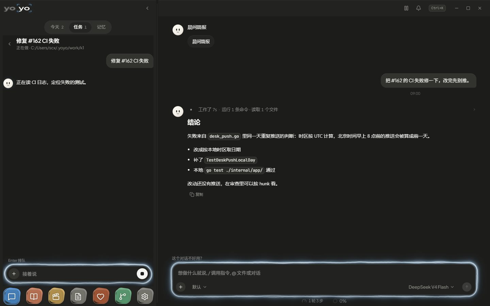

另外几处细节：

- 任务列表只有标题，没有状态。「正在做」「等你回答」「等你查看」三张工单看起来一样（`WorkPane.tsx:960-992`）。
- 记忆在左栏是一段叙述，在设置→个人里是一张带 `profile`、`semantic` 字样的原始列表，同一份数据两种样子。
- 简报卡片标题 22px（`WorkPane.tsx:390`），窄栏里一句话折成三行。
- 轮询偏密：编排快照每 2 秒（`WorkPane.tsx:61`），记忆每 4 秒，任务会话每 1 秒，铃铛每 15 秒，桌面简报每 30 秒。

### 1.3 值得保留的

- 对话的语法：一轮一个过程行、审批画在对话里、Plan 是输入框上的一个芯片（DESIGN.md §4）。这一套已经接近 Codex 和 DeepSeek Harness 的水准。
- 输入框工具条一行：`+`、权限、工作区、模型、发送，下面一行用量。
- 简报的证据纪律：按钮只把任务放进输入框，不直接发出；材料里没有的不写（proactive.md §4.3）。
- 球形机器人：它已经是 yoyo 最有辨识度的东西，适合作为 Agent 唯一的"脸"。
- 设置搜索、命令面板、桌面伴侣、手机门。

---

## 2. 一线产品怎么做

### 2.1 对照

| | Today AI | Muse | Dots | Grok Bot | DSH 编排面板 |
| --- | --- | --- | --- | --- | --- |
| 主界面 | 左边持续的对话流，右边个人面板：今天、任务、记忆、AI 伙伴 | 一条长的主对话，加侧对话；Goals、Library 等页签 | 每个任务一段对话；dot 的资料页分进行中、定时、已完成 | 左侧 Bot 名册，中间对话，右侧电脑预览和例行 | 先回答"有没有要我处理的"，再看健康，最后看一件事的来龙去脉 |
| 主动开口 | 早晚两次。只说"你希望有人告诉你的事"，其余折起来 | 只在有实质新进展或要你输入时通知；可以说"少一点 / 多一点" | 无人值守时只读研究；进展、问题、要你决定的事回到对话 | 只在需要你批准时回来 | 只在有人必须行动或结果用得上时开口 |
| 任务形态 | 任务就是一段会话，可以接着说；完成后更新记忆 | 后台工作，头像下显示正在做什么，点头像看活动记录 | Activity View 能看每一步、补充、改向、停止 | 名册上一句状态，比如"周五全员会的 deck 等你点头" | 工单状态互斥：进行中、等人、等触发、已结束 |
| 审批 | 发信、改日程前必须确认 | 结构化审批卡；默认放行浏览，只拦难撤销的 | 每类动作四档规则；草稿不等于授权发送 | 对话里的内联卡片，比如"可以发送"带发送、丢弃 | 授权只来自评估，工人不能擅自发 |
| 记忆 | 结构化事实，可读可改可删，能追到哪一条记忆驱动了建议 | Memory.md、Soul.md 可编辑，可以说"忘掉" | 目前不能逐条查看 | 没有记忆页面，静默保存 | 记忆是上下文，不是主动式本身 |
| 在场感 | 可以给 AI 起名、换性格 | 自己起名和设计头像 | 给 dot 起名 | 头像的表情就是状态：空闲、思考、工作、等待、受阻、完成 | 健康状态不占位置 |

依据：[Today AI 介绍](https://today.ai/articles/blog/what-is-today)、[品玩对 Today 界面的描述](https://www.pingwest.com/a/317164)、[Muse 发布](https://about.fb.com/news/2026/09/introducing-muse-personal-ai-agent/)、[How We Designed Muse](https://introducing.muse.ai/)、[Dots 发布](https://openai.com/index/introducing-dots/)、[Designing Grok Bot](https://x.ai/news/designing-grok-bot)、[DSH 005 Panel](../../dsh-superagent-prototype/docs/005-panel.md)。

### 2.2 借鉴清单

| 借鉴 | 来源 | 落到 yoyo |
| --- | --- | --- |
| 对话在中间，个人面板在右边 | Today AI | 第 4 节的三栏骨架 |
| 「需要你」永远第一，计数等于列表长度 | DSH 面板、Grok 名册 | 「今天」顶部的统一队列 |
| 一句话状态，而不是状态码 | Grok 名册 | 任务行、面板头部、导航轨头像的悬停提示 |
| 头像表情承载状态 | Grok、Muse | 球形机器人成为全局状态源 |
| 状态 → 预览 → 接管 三级访问 | Grok 的电脑访问 | 任务的三级打开 |
| 对话里出现结构化事件卡 | Grok 的异构对话 | 已交给任务、任务完成、已建定时、已记住 |
| 生成和推送是两件事 | Today AI | 简报总能拉开读，只有过门的才推到主对话 |
| 简报短、有尽头，空的部分不画 | Today AI、Microsoft Plan My Day、Pulse | 「就这些。」收尾，最多 5 块 |
| 每条建议都能看"为什么" | Today AI、Gemini Daily Brief | 卡片上的 ⓘ 弹层：依据、来源、记忆 |
| 动作按钮写出后果 | Muse、Dots | 审批卡写"运行这条命令""发出这封邮件" |
| 少一点 / 多一点 | Muse | 设置里的主动程度三档，面板头部菜单里也能改 |
| 例行是一个对象：时间、下次、试跑、暂停 | Grok、ChatGPT 定时任务 | 任务页签里的「定时」 |

### 2.3 不搬的

- 云电脑、每个 Agent 一套邮箱和钱包、Bot 名册（proactive.md §6 已经拒绝）。
- 一条刷不完的信息流。简报是有尽头的一份。
- 每张卡片都摆出「用上了 / 先不用 / 事实不对」。反馈默认从行为推断，显式反馈收进 ⋯ 菜单。
- 让"监督 Agent"变成主要工作的大面积执行画面。Grok 的结论是：执行画面越显眼，人越倾向于盯着它。

---

## 3. 设计原则

1. **注意力是预算。** 界面上每个徽标、每次通知、每张卡片，都要过和后端价值规则同一道门。健康的状态不占地方。
2. **一个主对话，多张工单。** 主对话只有一条。任务是有状态的对象，可以打开成会话，但主输入框只有一个。
3. **需要你的永远在最上面。** 不管来自审批、提问、来信还是任务，都进同一张队列，按等待时间和期限排序。
4. **形状跟着信息走。** 能用一行说清的不用卡片，能用卡片说清的不写段落。对话里允许出现结构化的事件卡。
5. **可追溯、可撤销。** 每条主动建议能看到依据；每次写入记忆都有一条回执和撤销；每个动作在活动记录里有一行。
6. **安静的底色，有意义的高光。** 底色克制：中性石色、细线、一个强调色。高光留给状态：在跑、等你、出错，以及启动时的品牌时刻。

---

## 4. 信息架构与布局

### 4.1 三栏骨架

```
┌────┬────────────────────────────────────┬──────────────────────────┐
│ ●  │ 主对话 · 今天            Ctrl K  ▣  │ ● yoyo  正在做 1 件·3 件等你 ⋯│
│    │                                    │ 今天 3   任务 1•   记忆      │
│ 主页│ ── 今天 · 11月6日 周五 ──          │ 11月6日 周五                 │
│ 视频│ [☀ 晨间简报 · 2 件要你确认  查看 ›]  │ 需要你 3                     │
│ 学习│                     [用户气泡]      │  ● 起草本周周报 等你回答 [回答]│
│ 技能│ ◉ 交给任务去做……                   │  ● 评审材料 等你看一眼 [查看] │
│    │                                    │  ⌥ #163 Windows 构建 [接受]  │
│ 偶像│   [已交给任务 · 修复 #162   查看]    │ 在做的事（卡片）             │
│ 实验│   ✓ 已记住：改完先别推 · 撤销        │ 接下来（卡片）               │
│    │                                    │ 就这些。还有 3 条可以等 ›     │
│ 设置│ [ 输入框：+ 询问后执行 yoyo 模型 ↑ ] │                              │
└────┴────────────────────────────────────┴──────────────────────────┘
 64px          弹性（对话列最多 736px）            400px（340–480 可拖）
```

- **左：导航轨。** 所有模块共用。宽 64px，图标在上、短标签在下，常显。顶部是 Agent 头像，底部是设置。
- **中：主对话。** 对话列居中，最多 736px。按天分隔。
- **右：个人面板。** 头部是 Agent 的身份和一句状态，下面三个页签：今天、任务、记忆。面板有三种内容：页签、任务会话、审查。
- **其他模块**（视频、学习、技能、实验室、偶像、设置）：导航轨右边接自己的模块栏（220–240px），右侧面板按模块需要出现。这条和"每个大模块有自己的左侧栏"一致。

### 4.2 尺寸与断点

| 窗口宽度 | 导航轨 | 主对话 | 个人面板 |
| --- | --- | --- | --- |
| ≥ 1280 | 64px | 弹性 | 400px，常驻，可拖到 340–480 |
| 1100–1279 | 64px | 弹性 | 360px |
| 800–1099 | 64px | 弹性 | 收起；顶栏按钮带「需要你」徽标，点开从右侧滑出 |
| < 800（手机浏览器门） | 换成底部标签栏：主页、任务、记忆、更多 | 整页 | 整页 |

模块栏宽度按模块固定，不再继承主页面板的宽度。`lib/layout.ts` 的持久化按表面分开存。

### 4.3 导航轨

| 位置 | 内容 | 规则 |
| --- | --- | --- |
| 顶部 | Agent 头像（球形机器人，28px） | 表情跟全局状态走；外圈细环表示在做事，右下角琥珀点表示有事等你。悬停显示"正在跑 go test · 修复 #162"，点击打开活动记录 |
| 中部 | 主页、视频、学习、技能、偶像、实验室 | 18px 单色图标 + 11px 标签。当前项：底色 `lift` + 左侧 3px 强调色短条。主页的徽标只数「需要你」 |
| 底部 | 设置 | 同上 |

- 学习换成学位帽图标，技能换成积木图标。现在学习用文件图标、技能用书本图标，两者容易混。
- 「Harness」在导航里叫「实验室」，悬停提示写"Harness：改进与评测"。
- 暂停主动工作从顶栏移到头像菜单里，暂停时头像闭眼，对话顶部出现一条横幅。
- GlassIcons 保留，改成竖排：统一中性玻璃底，当前项用强调色，去掉倾斜视差，保留按压反馈，标签常显。

### 4.4 个人面板

- **头部**：小头像 + 名字（可改名，对应 Today AI 的"AI 伙伴"）+ 一句状态"正在做 1 件 · 3 件等你" + ⋯ 菜单（主动程度：少一点 / 适中 / 多一点；暂停主动工作；简报偏好）。
- **页签**：用 DESIGN.md §5 的下划线文字页签，不用胶囊分段。计数是小号等宽数字；「今天」的计数只数需要你，用琥珀色；「任务」的计数是进行中的数量，用灰色，有任务等你时加一个琥珀点。
- **三种内容**：
  1. 页签内容：今天、任务、记忆。
  2. 任务会话：从任务行点进来，头部有返回。
  3. 审查：改动、文件、浏览器、轨迹、用量。打开时面板默认加宽到窗口的 46%，头部写"← 返回今天"。

### 4.5 任务的三级打开

| 级别 | 在哪 | 能做什么 |
| --- | --- | --- |
| 状态 | 任务页签里的一行 | 一句话状态、来源、时间 |
| 预览（默认） | 右侧面板里的任务会话 | 看步骤和回报，回答问题卡，用次级输入框接着说 |
| 聚焦 | 点 ⤢ 展开到中间，主对话收到面包屑后面 | 长时间配合。输入框左侧出现目标芯片"发给：修复 #162" |

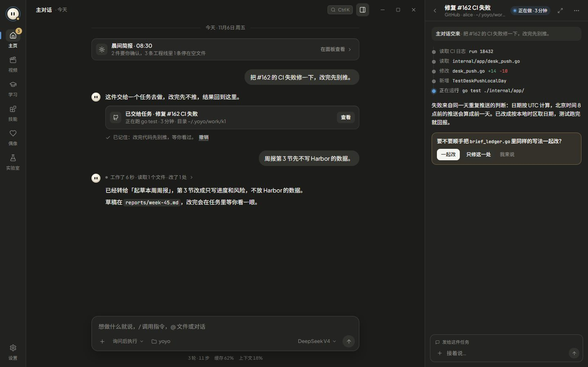

- 任务会话就是一段完整会话，不带身份设置，结束或停下之后仍然可以接着说。
- 次级输入框是普通细线样式，上方写"发给这件任务"，没有电流边框。主对话的输入框始终是最亮的那个。
- 问题卡把选项做成按钮，比如"一起改 / 只修这一处 / 我来说"。回答问题不需要打字。

### 4.6 功能去向

保证不减功能：每一项现在的功能都有明确的新位置。

| 现在在哪 | 以后在哪 |
| --- | --- |
| 左栏「今天」的简报 | 右侧面板「今天」 |
| 左栏「今天」的待接受来信 | 「今天」顶部「需要你」 |
| 左栏「任务」 | 右侧面板「任务」，按状态分组 |
| 左栏任务详情（第二个输入框） | 右侧面板的任务会话；可以聚焦到中间 |
| 左栏「记忆」 | 右侧面板「记忆」 |
| 左栏的审查模式 | 右侧面板的审查模式 |
| 底部七色玻璃坞 | 左侧竖排导航轨 |
| 顶栏铃铛（通知、审批、收件、草稿） | 「需要你」队列；只是信息的通知进活动记录 |
| 顶栏暂停按钮 | 导航轨头像菜单 |
| 简报弹层 `BriefOverlay` | 对话里的简报事件卡，点击跳到面板里的那一期 |
| 简报偏好（存在浏览器 localStorage） | 设置→主动与通知，写进 `config.yaml` |
| 按住的类别、公开检索开关（功能线正在加，放在简报偏好页里） | 设置→主动与通知；「今天」⋯ 菜单里有入口 |
| 设置→个人→记忆 | 记忆页签 |
| 设置→个人→定时任务、目标、监视 | 任务页签→定时 |
| 设置→个人→事务、想法 | 任务页签；想法进「今天」的"可以等" |
| 设置→个人→发送审阅 | 「需要你」 |
| 设置→偶像 | 偶像模块右上角的齿轮；设置里留一个入口行 |
| 设置→外观→显示里的实验室开关 | 实验室模块 |

---

## 5. 关键界面

### 5.1 今天

结构从上到下：

1. **日期头**：「11月6日 周五」（20px/600），下面一行"晨间简报 · 08:30 写成"。没核对的来源写明，比如"日历未连接，日程未核对"（proactive.md §5 第 6 步）。右侧是简报偏好按钮。
2. **需要你**：见 5.2。没有时这一块不画，日期头下面写一句"今天没有需要你的事。"
3. **简报卡片**：最多 4 张，加上需要你一共不超过 5 块。卡片顺序跟后端价值规则一致：到期、等人或卡住、来源出错、工程线状态变化、第一封欢迎信。
4. **接下来**：今天和明早有时间的事，时间左对齐、等宽数字，带来源标签（任务 / 定时 / 飞书 / 日历）。
5. **结尾**："就这些。还有 3 条可以等 ›"。可以等的事收在这里，展开后是一张普通列表。

卡片规则：

- 结构：kicker（12px，强调色）→ 标题（15px/600）→ 导语（12px）→ 正文 → 底部（一个主动作、可选的次动作、ⓘ、⋯）。现有的 8 种 layout（checks、compare、evidence、chips、plain、letter、rows、stats）保留，统一换成这套字号和 12px 圆角，不再用渐变底和投影。
- 动作仍然只把任务放进输入框；「接受 / 忽略」这类可逆操作可以直接执行。
- **反馈默认隐式**：点了动作算用上了；看过没点不算差评。显式反馈只在 ⋯ 菜单里：这类先少提、今天别再提醒、事实不对。这三项对应后端已有的反馈种类。
- **为什么**：点 ⓘ 弹出依据、来源和时间、用到的记忆，见下图。
- 历史简报不在「今天」里堆叠。更早的期在日期头的下拉里按天切换。

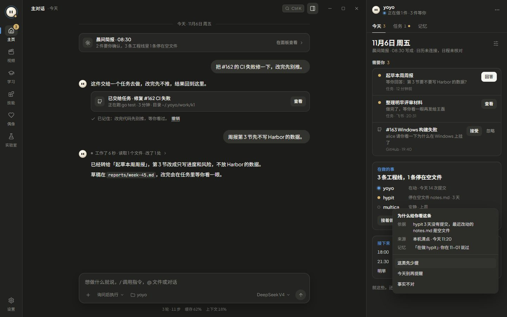

晚间收尾沿用同一结构：日期头写"晚间收尾"，第一块是"滑到明天的 N 件"，只问一个决定。

### 5.2 需要你

一张队列，收所有需要人决定的东西：

| 来源 | 一行写什么 | 主动作 |
| --- | --- | --- |
| 工具审批（主对话或任务） | "运行 `go test ./...`" + 会话名 | 允许一次 / 本对话 / 拒绝 |
| 任务提问 | "起草本周周报 · 等你回答：第 3 节要不要写 Harbor 的数据？" | 回答（打开任务会话并定位到问题卡） |
| 任务待查看 | "整理明早评审材料 · 做完了，等你看一眼" | 查看 |
| 来信待接受 | "#163 Windows 构建失败 · alice" | 接受 / 忽略 |
| 到期日程 | "10:00 产品周会 · 今天到期" | 准备 |
| 失败、受阻、未送达 | "回复 #158 没送出去 · 网络错误" | 重试 / 查看 |
| 待发送的草稿 | "给王磊的邮件 · 等你确认发出" | 发出这封 / 改一下 |

- 排序：过期 → 今天到期 → 等待时间长的 → 其他。
- 计数等于列出的条数。超过 5 条时显示前 5 条和"还有 N 条"。
- 对话里的审批卡照旧画在对话里，这里是镜像。在任一处处理，另一处同步消失。
- 顶栏铃铛去掉。只是信息的通知（比如"更新已下载"）进活动记录。

### 5.3 任务与定时

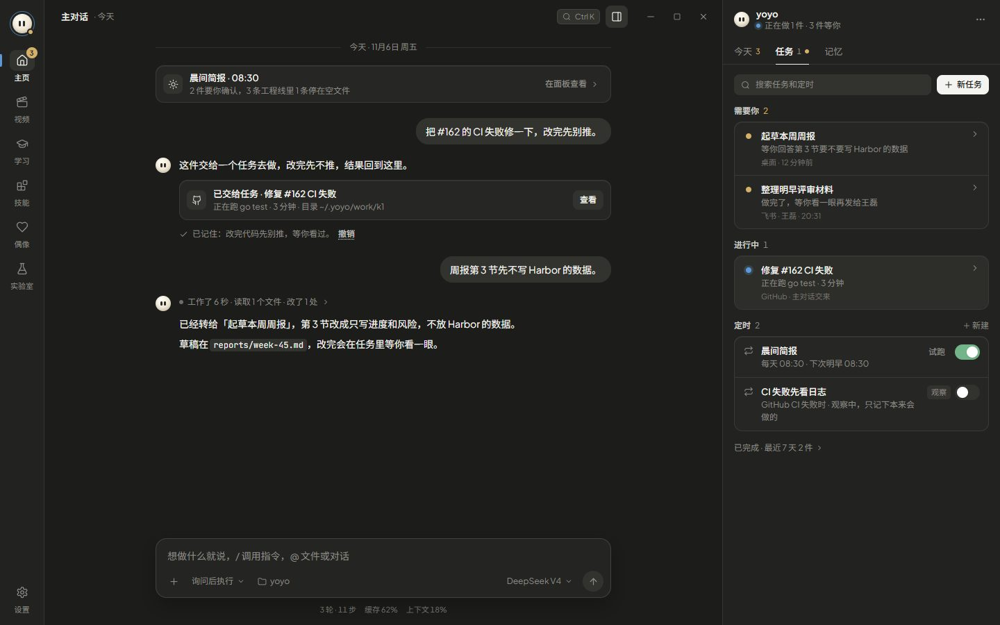

- **分组**：需要你 → 进行中 → 定时 → 已完成（最近 7 天，默认折叠）。空组不画。
- **一行的结构**：状态点 · 标题（13px/500）· 一句状态（12px）· 元信息（11px：来源 · 谁 · 时间）· 右箭头。
- **一句状态**要写人话，参照 Grok 名册："等你回答第 3 节要不要写 Harbor 的数据""正在跑 go test · 3 分钟""做完了，等你看一眼""停下了，说一句就会接着做"。
- **状态点**：琥珀 = 需要你，蓝 = 在跑（只有在跑时才有外圈），绿 = 完成，红 = 失败，空心灰 = 安静。
- **定时**是一个对象：名字、用文字写的时间（"每天 08:30"）、下次运行、模式标签（观察 / 自动）、试跑、开关。新建时把"每天……提醒我……"放进输入框，或者从推荐模板里选。
- 顶部只有搜索和「新任务」。现在"搜索框和定时开关并排成两个胶囊"的写法去掉。

### 5.4 记忆

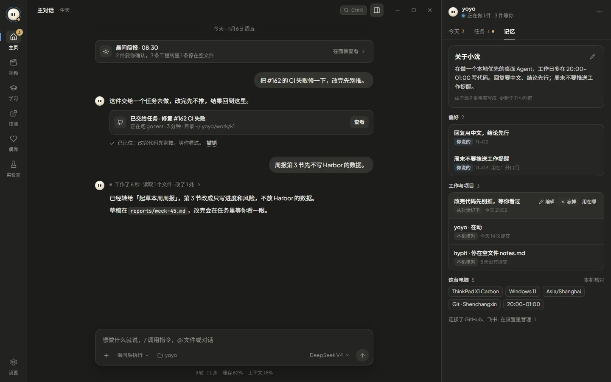

- **关于你**：两三句话，由事实写成，可以直接编辑。下面写"由 9 条事实写成 · 更新于 11 小时前"。
- **分组**：关于你、偏好、工作与项目、这台电脑、笔记。对应现有的 `MemoryFolder`，和 Today AI 按领域分组的做法一致。以后记忆里有了人物，再加一组「人」。
- **一行**：事实本身 · 来源标签（你说的 / 本机核对 / 从对话记下 / 任务写回）· 日期 · "用在：开口门 / 简报"。悬停出现编辑、忘掉、用在哪。
- **回执**：每次写入记忆，对话里出现一行"已记住：…… · 撤销"。不弹窗、不让人选「留下 / 忘掉」。
- 这台电脑的事实用小标签平铺，不占五行。
- 设置里的记忆列表去掉，只留一个入口行。

### 5.5 主对话

**事件卡**：对话里出现的结构化对象统一成一个样式（图标块 + 标题 + 一句说明 + 动作）。

| 事件 | 标题 | 动作 |
| --- | --- | --- |
| 简报推送（过了门） | 晨间简报 · 08:30 / 2 件需要你…… | 在面板查看 |
| 交给任务 | 已交给任务 · 修复 #162 CI 失败 / 正在跑 go test · 3 分钟 | 查看 |
| 任务完成 | 任务完成 · 修复 #162 / 改了 2 个文件，本地测试通过，还没推送 | 审查改动 · 打开任务 |
| 任务失败 | 没做成 · 回复 #158 / 网络错误，第 2 次 | 重试 · 打开任务 |
| 新建定时 | 已建定时 · 每天 08:30 晨间简报 | 试跑 · 暂停 |
| 记住了 | 已记住：改完代码先别推（单行回执，不用卡片） | 撤销 |

**其他规则**：

- 按天分隔（"今天 · 11月6日 周五""昨天"）。
- 简报推送只是一张单行事件卡，点击把右侧面板切到「今天」并定位到那一期。不再弹模态层。
- 审批卡的主按钮写出后果："运行这条命令""发出这封邮件"。范围选项（一次、本对话、总是）和拒绝放在后面。
- "这个对话不好用？"链接不再常驻。只在出错或连续重试之后出现，平时收进 ⋯。
- 输入框见 6.5。只有一个主输入框；聚焦任务时左侧出现目标芯片。

### 5.6 在场与打断分级

全局状态只有一个来源：后端的工单和开口门。导航轨头像、面板头部、桌面伴侣三处读同一个状态。

| 级别 | 什么时候 | 怎么表现 |
| --- | --- | --- |
| L0 只记下 | 门判沉默；观察模式下本来会做的事 | 活动记录里"会说但没说"的一行 |
| L1 环境 | 有进展，但不需要你 | 头像表情、任务计数、伴侣的待机动作 |
| L2 一瞥 | 新的「需要你」、简报写成、任务完成 | 主页徽标 +1；伴侣冒一句，不抢焦点；托盘图标加一个点 |
| L3 打断 | 要你决定且有时限；阻塞性失败；你说过"做完叫我" | 系统通知，伴侣同时说话；点通知直达那一条 |

- 安静时段里 L3 降成 L2。周末偏好来自记忆（"周末不要推送工作提醒"）。
- 同一类一天只开口一次；连续三次没用，这一类被按住。这两条和 proactive.md §4.2 的价值规则一致，界面只负责表现。
- 头像表情：空闲时平静，接到工作点一下头，在做时外圈转动，等你时看向你并出现琥珀点，受阻时皱眉，完成后舒展。Emotion Ball 已经有这些表情，只需要接上状态。

### 5.7 第一次打开

- 主对话里 Agent 先开口："你好，我是 yoyo。我已经从这台电脑上知道了一点你的事。"然后列三条本机核对过的事实，问一个问题："先帮你盯哪件事？"下面是选项芯片（从工程线里认出的项目名，加上"写代码 / 做视频 / 学东西 / 整理事务"）。全部可以跳过。
- 右侧面板的「今天」显示欢迎信（现有的 welcome 逻辑）。
- 权限按需申请：要读日历时才问日历，不在第一屏摆一排连接按钮（Today AI 的渐进授权）。

---

## 6. 视觉与动效规范 v2

色值沿用 `styles.css` 的安静石色和 Codex 蓝，不换品牌色。改的是刻度：把随手写的数值收成有限几级，并用守卫防止回退。

### 6.1 字号：18 种 → 7 级

| 令牌 | 字号/行高 | 用在 |
| --- | --- | --- |
| `caption` | 11 / 16 | 元信息、kbd、计数 |
| `footnote` | 12 / 18 | 次要文字、导语、按钮 |
| `body` | 13 / 20 | 界面默认、列表标题 |
| `body-l` | 14 / 22 | 对话正文、用户气泡 |
| `title-s` | 15 / 22 | 卡片标题、分区标题 |
| `title` | 17 / 24 | 页面标题 |
| `display` | 20 / 28 | 「今天」的日期头、空状态 |

对话正文保持 DESIGN.md 里的 14px / 1.65；代码 12px，关闭连字。DESIGN.md 里的 12.5px（过程行）、10.5px（眉标）、11.5px（元信息）分别归到 12、11、11。

### 6.2 圆角、间距、高度

- 圆角 6 级：`xs 4`（kbd、小标签）· `sm 6`（图标按钮）· `md 8`（按钮、输入、芯片）· `lg 12`（卡片、列表组、菜单）· `xl 16`（主输入框、面板、对话框）· `full`（头像、开关、状态点）。嵌套时内圆角 = 外圆角 − 内边距，和 DSH 的圆角标准一致。去掉 R20、R24、R28。
- 间距：4pt 网格。模块之间 16，组内 8–12，组件内 4–8。
- 行高：列表行 32 / 44（两行）/ 56（三行），工具条 36，顶栏 48，面板头 56。

### 6.3 颜色：加一组状态语义令牌

| 令牌 | 映射 | 含义 |
| --- | --- | --- |
| `--status-needs` | `--warning` | 需要你 |
| `--status-live` | `--accent` | 正在做 |
| `--status-done` | `--success` | 完成、健康 |
| `--status-failed` | `--danger` | 失败、破坏性操作 |
| `--status-idle` | `--muted` | 安静、未开始 |

- 颜色只出现在状态点、计数、diff 和破坏性按钮上。导航图标、卡片底色、按钮都不带色相。
- 主按钮是墨色填充（`foreground` 底、`background` 字），强调色只用于选中、焦点和"在跑"。现在简报里的蓝色胶囊主按钮改成墨色。

### 6.4 组件家族

一套卡片语法覆盖所有主动式对象：

| 组件 | 结构 | 现在对应 |
| --- | --- | --- |
| 行 `Row` | 状态点或来源图标 · 标题 · 一句说明 · 元信息 · 右侧动作 | 任务行、需要你、记忆行 |
| 事件卡 `EventCard` | 28px 图标块 · 标题 · 说明 · 动作 | 对话里的简报芯片、交给任务、任务完成 |
| 简报卡 `BriefCard` | kicker · 标题 · 导语 · 正文 · 底部 | `BriefStack` 的 8 种 layout |
| 问题卡 `AskCard` | 琥珀细边 · 问题 · 选项按钮 · 自由回答 | `AskDeck`、任务提问 |
| 审批卡 `ApprovalCard` | 后果动词按钮 · 范围 · 拒绝 · 展开详情 | 对话审批、`InboxMenu` 的审批 |
| 回执 `Receipt` | 勾 · 一句话 · 撤销 | 新增 |

共同点：12px 圆角，细线边，内边距 12–14，标题 13–15px，按钮 24–28px 高，卡片里不再套卡片。

### 6.5 动效预算

已经接入的 React Bits 组件都保留，改的是触发条件。规则：同一屏同时最多一个持续动效；持续动效必须对应一个正在发生的状态；窗口失焦 30 秒后全部暂停；`prefers-reduced-motion` 时全部停止。

| 组件 | 现在 | 以后 |
| --- | --- | --- |
| ElectricBorder（输入框电流） | 所有输入框常驻，WebGL，跟随鼠标 | 只给主输入框。空闲是静态细线；聚焦时一圈柔和静态光；Agent 在跑时电流流动；等审批时变成静态琥珀边。任务会话、学习导师的输入框用普通细线 |
| GlassIcons（玻璃图标） | 底部横排，七种颜色，倾斜视差，标签悬停才出现 | 竖排导航轨，统一中性玻璃，当前项用强调色，标签常显，去视差，保留按压 |
| TrueFocus（字标聚焦） | 每 1.6 秒循环一次 | 启动和悬停时各跑一次 |
| TextType（标题打字） | 标题变化就打字 | 只在 Agent 第一次给会话起标题时 |
| Counter（滚动数字） | 计时器 | 保留，跟状态走 |
| ThoughtLine、shimmer | 思考中 | 保留，跟状态走 |
| Emotion Ball（球形机器人） | 对话戳、空状态、桌宠各自一套 | 唯一的"脸"：导航轨头像、面板头像、对话戳、桌面伴侣读同一个状态源 |

这条预算同时是性能项。现在每个输入框都带一个 WebGL2 上下文，只要窗口可见就按帧率渲染；打开任务会话时屏幕上有两个。改成按状态触发后，空闲时没有持续渲染的 WebGL。主动式 Agent 整天挂在桌面上，空闲功耗比动画好看更重要。

### 6.6 守卫

- 功能代码里禁止 `text-[Npx]` 和 `rounded-[Npx]`，只能用令牌类。参照 DSH 的圆角守卫，在 CI 里加一条 grep 检查，现有用法列进豁免名单逐步清掉。
- 禁止在功能代码里写渐变和投影类；投影只走 `--shadow-*` 令牌。
- 每个新组件先查 6.4 的家族表，能复用就不新写。

---

## 7. 设置精简：11 页 47 节 → 8 页 26 节

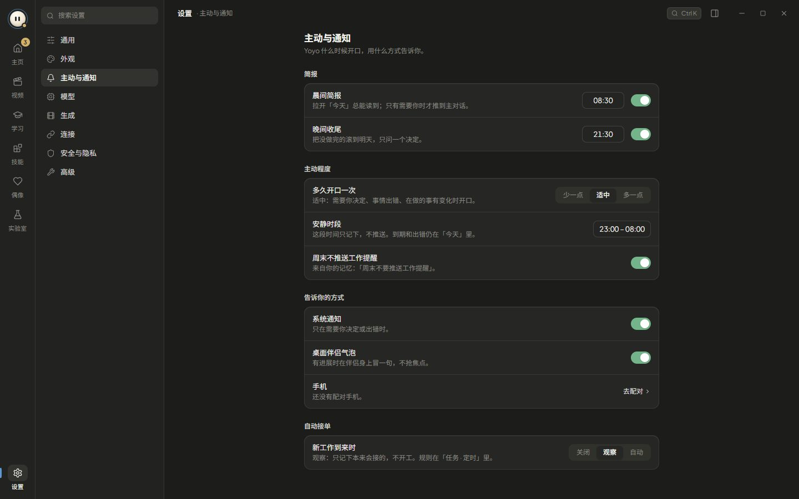

### 7.1 新结构

| 页 | 节 | 来自 |
| --- | --- | --- |
| 通用 | 工作区 · 窗口与启动 · 语言 · 快捷键 | 通用（原 4 节）+ 外观→显示里的语言 |
| 外观 | 主题 · 壁纸 · 对话显示 | 颜色模式和色板合成一个主题选择；界面尺寸、思考过程、工作细节合成"对话显示" |
| **主动与通知**（新） | 简报 · 主动程度 · 告诉你的方式 · 自动接单 | WorkPane 的简报偏好、按住的类别、通用→通知、编排的关闭/观察/自动 |
| 模型 | 提供商与密钥 · 模型目录 | 不变 |
| 生成 | 短片与短剧默认 · 服务目录 | 原 12 节合成一个服务目录，用类别筛选：图片、视频、语音、配乐、抠像、素材、转写、存储、搜索、工作流、画布通道 |
| 连接 | 应用 · 消息机器人 · MCP 服务器 · 手机 | 连接应用 + 扩展→工作来源（GitHub、飞书）+ 消息的两节 + 扩展→MCP + 高级→手机 |
| 安全与隐私 | 审批 · 预算 · 运行环境 · 数据与记忆 | 安全原 4 节，命令行运行时折进运行环境；新增数据入口（导出、清空、去记忆页） |
| 高级 | 更新 · 诊断 · 插件与实验室 | 日志、本机检查、审计记录合成诊断；WASM 插件和实验室显示开关放这里 |

合计 4 + 3 + 4 + 2 + 2 + 4 + 4 + 3 = 26 节。旧的深链继续由 `registry.ts` 里的 `LEGACY_TABS`、`LEGACY_SECTIONS` 重定向。

### 7.2 去掉或收起的配置项

| 配置项 | 处理 |
| --- | --- |
| 通知→"仅在失焦时" | 去掉开关，改成默认行为：窗口在前台时不弹系统通知 |
| 色板（多种深色、浅色） | 深浅各留 2–3 个；更多换肤交给壁纸和皮肤 |
| 显示思考 / 对话视图 / 折叠计时 三个开关 | 合成"对话显示：简洁 / 详细"和一个"显示思考过程" |
| 外观里的实验室开关（sealed、BoN、哈希） | 搬到实验室模块 |
| 消息机器人的每人限速、分段发送、群里点名、回调地址和端口 | 收进每个机器人的"高级"折叠区，默认值不变 |
| 生成的存储、搜索、工作流 | 在服务目录里用"更多"筛选，不单独成节 |
| 命令行运行时 | 折进运行环境的"高级" |
| 个人页的 7 节 | 搬回记忆、任务、需要你（见 4.6） |
| 偶像页的 3 节 | 搬进偶像模块 |

### 7.3 设置页的版式

- 内容列最多 720px，居中。页面标题 17px，下面一句话说明。
- 分组表单：12px 圆角卡片，行间细线，标签在左、控件在右；说明文字 12px，一行写完。
- 高级参数默认折叠。每块只在有改动时出现保存条（DSH 005 的规则）。

---

## 8. 文案

### 8.1 词表

| 系统里的词 | 界面上写 |
| --- | --- |
| 工单 ticket | 任务 |
| 触发 trigger | 来信、请求 |
| 准入 / 准入模式 | 自动接单 |
| observe / auto | 观察 / 自动 |
| 去向 disposition、held | 会说但没说 |
| 开口门、价值规则 | （不出现，用"为什么给你看这条"解释） |
| hunk | 改动块 |
| harness / refs/active | 工作方式 / 正在使用的版本（实验室里可以出现原词） |
| fiber | 插件 |
| profile / semantic / episodic | 关于你 / 偏好 / 经历 |

### 8.2 主动开口的写法

一条推送最多两行，按这个顺序：发生了什么 → 为什么是现在 → 你可以做什么。

- 好："hypit 停在空文件 notes.md 已经 3 天。要接着做的话，我先列个下一步。"
- 不好："检测到工程线状态从 moving 变为 stalled，建议处理。"

### 8.3 要清掉的说明书文案（举例）

- 视频→创作的案例区："目录 yoyo.creation-cases 共 22 条。封面是 /short-drama-styles 里的画风参考静帧……"改成"点一个案例，会把做法放进上面的输入框。"
- 技能页顶部的四行说明压成一句："已安装的技能可以在对话里用 @ 调用。"其余放进 ⓘ。
- 设置→扩展："WASM 保持 HighRisk + ForceAsk，没有 WASI 文件系统。"改成"插件每次运行都会先问你。"

---

## 9. 其他模块

不删功能，只统一骨架、令牌和文案。

| 模块 | 调整 |
| --- | --- |
| 视频 | 保留四条车道和成片台，左侧模块栏仍是 `VideoShellNav`。输入框按 6.5 只在生成中流动。案例区去掉内部 id 和路径 |
| 学习 | 「今日」改名「学习计划」，避免和主页的「今天」撞名。导师对话和主对话保持分开，右侧导师的输入框用次级样式 |
| 技能 | 已安装、市场、包三个页签不变；顶部说明压成一句 |
| 实验室 | 导航里叫实验室；首页一句话 + 一个动词按钮（现在已接近）；refs、canary、staging 放进详情 |
| 偶像 | 设置搬进模块；桌面伴侣和主窗口头像共用状态源；改名、换性格对应 Today AI 的"AI 伙伴" |
| 手机 / 浏览器门 | 窄屏下导航轨变底部标签栏，个人面板变整页 |

---

## 10. 落地路线

| 期 | 范围 | 主要文件 | 依赖 | 验收 |
| --- | --- | --- | --- | --- |
| **P0 骨架与令牌**（3–4 天） | 7 级字号、6 级圆角、状态令牌；导航轨（RailDock 竖排、标签常显、主页徽标）；`WorkPane` 从左栏移到右侧面板；审查放回右侧；模块栏宽度按表面分开；ElectricBorder、TrueFocus、TextType 改成按状态触发；守卫上 CI | `App.tsx`、`features/shell/RailDock.tsx`、`GlassIcons.tsx`、`ThreadRail.tsx`、`lib/layout.ts`、`lib/rail-body.ts`、`session-chrome/ChatBorder.tsx`、`Titlebar.tsx`、`styles.css` | 无。不碰主动式逻辑，可以和功能线并行 | 屏幕上最多一个发亮的输入框；空闲时没有持续动画；e2e 冒烟通过 |
| **P1 今天与需要你**（4–5 天） | 简报卡换成新卡片家族；统一「需要你」队列（并入铃铛、审批、来信、任务提问）；简报弹层换成事件卡跳转；ⓘ 弹层和 ⋯ 反馈菜单；徽标规则 | `superagent/WorkPane.tsx`、`work-model.ts`、`BriefOverlay.tsx`、`InboxMenu.tsx`、`Titlebar.tsx`、`Transcript.tsx` | 开口门给每条信号带上依据和来源（`Initiative.signals`） | 打开应用第一屏能看到需要你和今天的简报；需要你只在一处列出 |
| **P2 任务、任务会话、记忆**（5 天） | 任务分组和一句状态；定时对象（试跑、下次、模式）；任务会话在面板里，次级输入框，可聚焦到中间；记忆分组、来源、回执、行内忘掉；删掉设置里的记忆列表 | `WorkPane.tsx`、`TaskPage.tsx`、`Composer.tsx`（次级样式和目标芯片）、`Transcript.tsx`（事件卡）、`settings/PersonalPanel.tsx` | 记忆行带来源和"用在哪"（功能线正在加 `memoryOrigin`） | 五个可用性任务都能在 30 秒内完成（见 11） |
| **P3 设置与文案**（3–4 天） | `registry.ts` 改成 8 页 26 节，旧链接重定向；新增主动与通知页；简报偏好进 `config.yaml`；按词表过一遍文案 | `settings/registry.ts`、`pages.tsx`、`PersonalPanel.tsx`、`MessagingSettings.tsx`、`GenerationSettings.tsx`、`ConnectorsSettings.tsx`、`lib/copy-zh.ts`、`lib/copy.ts`；Go 侧的配置字段 | Go 侧新增简报时间、主动程度、安静时段三个配置字段 | 设置里不再出现记忆或任务列表；旧深链全部能打开 |
| **P4 在场与首启**（3–4 天） | 头像状态源（导航轨、面板、伴侣）；活动记录；打断分级接到系统通知和伴侣气泡；安静时段；首启引导 | `features/presence/*`、`internal/desktop/pulse.go`、`companion.go`、`superagent/view.go`、`useWorkstation.ts` | 后端给出全局状态一句话和活动流 | 一个早晨没有到期、没有卡住时，不弹任何通知 |

和正在进行的主动式功能线的关系：

- 功能线负责"判断"：价值规则、去向、反馈、按住的类别、记忆来源、任务分组。本方案负责"表现"：位置、组件、打断分级。
- P0 可以马上做，不依赖功能线。P1、P2 等功能线把字段定下来再接，界面先按本方案的组件搭好。
- 采纳之后，DESIGN.md 的 §1 原则、§3 布局、§2 令牌，以及 `design-system/yoyo/MASTER.md` 按本方案更新。DESIGN.md 仍然是规则的唯一来源。

---

## 11. 验收指标

| 维度 | 现在 | 目标 |
| --- | --- | --- |
| 同一屏的主输入框 | 最多 2 个，都发亮 | 1 个；任务会话是次级样式 |
| 列出「需要你」的位置 | 6 处 | 1 处，其余只有徽标 |
| 功能代码的字号种类 | 18 | 7 |
| 随手写的圆角 | 12 种 | 0 |
| 空闲时的持续动画 | 2 处（输入框电流、字标聚焦） | 0 |
| 设置 | 11 页 47 节 | 8 页 26 节 |
| 前端轮询 | 1 秒、2 秒、4 秒、15 秒、30 秒并存 | 改成事件驱动；兜底轮询不低于 10 秒 |

主动式效果沿用 proactive.md §7 的口径（假阳性、假阴性、越权），另外从后端已有的反馈记录里看三个数：推送被点开的比例、"这类先少提"的比例、被按住的类别数。

可用性测试，五个任务各在 30 秒、两次点击以内完成：

1. 找到现在需要你处理的事。
2. 回答一个任务提出的问题。
3. 改掉一条写错的记忆。
4. 关掉一类提醒。
5. 把"写周报"交给一个任务，然后回到主对话。

---

## 附：现状与改造对照

| 现状 | 改造后 |
| --- | --- |
|  |  |
| 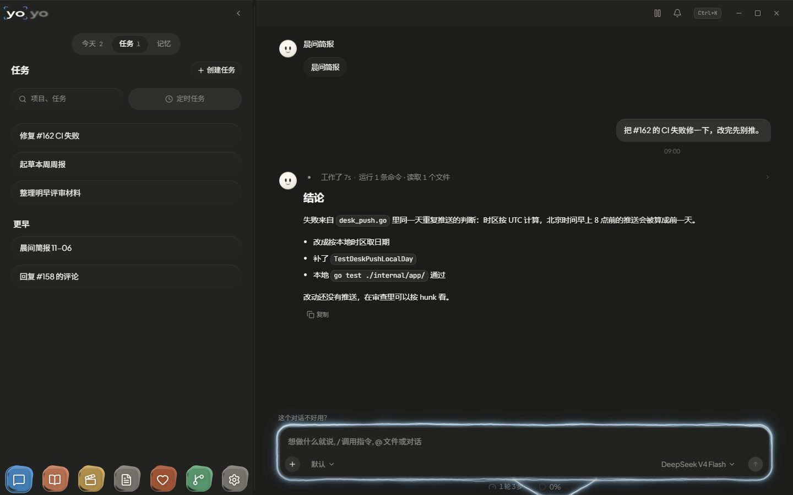 |  |
|  |  |
| 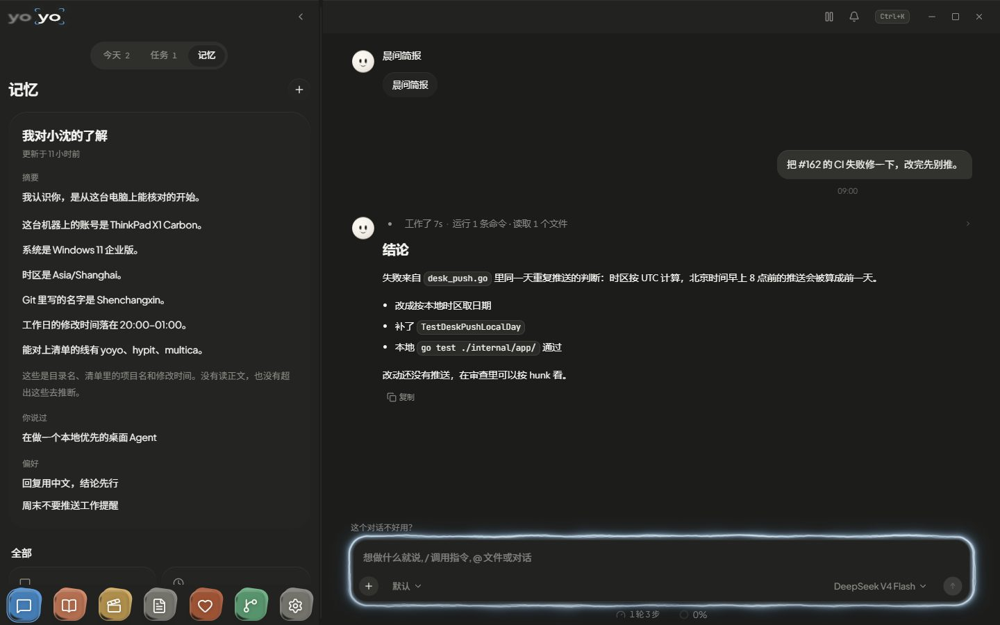 |  |
| 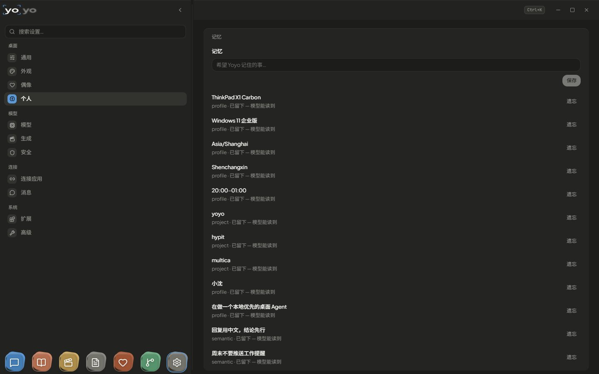 |  |

浅色主题：

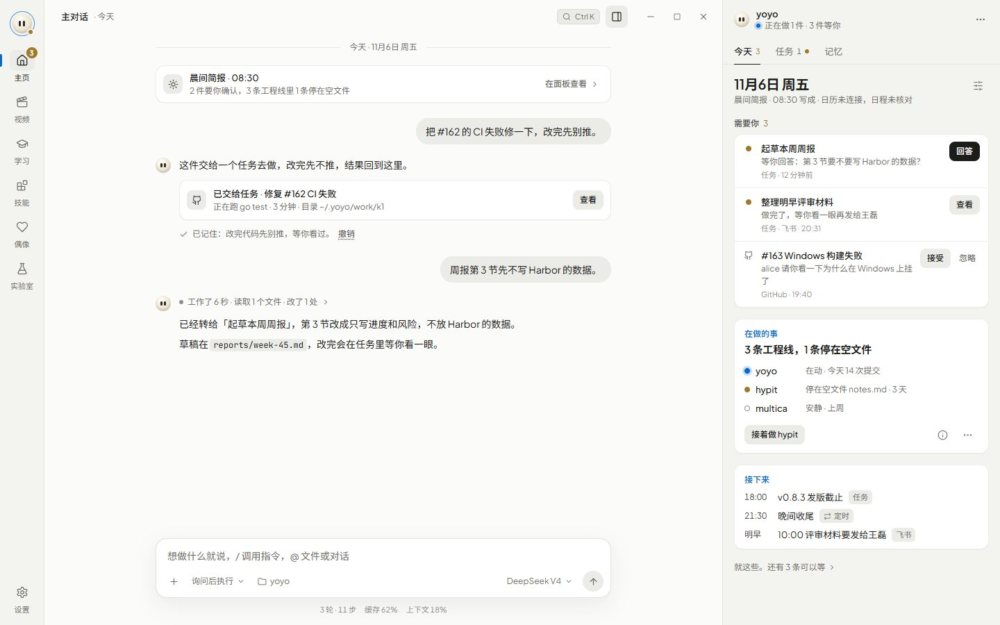

---

## 附：落地记录（2026-11-06）

按本方案落地，布局不采用 Today AI 的三栏：保留左栏（今天 / 任务 / 记忆）、底部玻璃坞、中间对话，审查仍在左栏里打开。§4 的信息架构里只有"布局"一项没做，其余各期都已落地。下面的截图来自 e2e 模拟数据下的真实界面，不是设计稿。

走查后的调整：左栏今天、任务、记忆和底部玻璃坞保留原来的视觉（参考 Today AI 的胶囊页签、居中日期、大圆角卡片、记忆文件夹格子，以及彩色倾斜的玻璃图标）。新增的交互都按原来的样式放进去：「需要你」的各类条目、简报卡右上角的 ⓘ、往期切换、右上角圆钮里的主动程度和最近动态、定时开关、任务放到中间、坞上的「需要你」数字。这两处的字号和圆角沿用原来的写法，令牌守卫基线相应放宽。

第二轮走查：

- 「今天」只放日期、「需要你」（有事时才出现）和简报。状态一句话、"今天没有需要你做的事"、「接下来」和收尾语都去掉了。
- 简报改成看板。报头写清哪一期、几点写好、写完不再改，带处理进度和一排目录，点目录跳到那张卡。每张卡有类别图标和颜色；清单可以逐条勾掉，条目可以「追问」（放进输入框，不替你发）；工程线带状态标签；数字成块；两件事挑一件时可以直接点选项；记住的事排成时间线。勾选、点选、收起都只是你的标记，存在 `picked` 里，卡上的内容写完不变。打开前就处理完的卡收成一行，刚处理的留在展开的样子，可以撤销。规则在 `features/superagent/brief-board.ts`，有单测。
- 底部坞在会话页和其他模块一样大：按模块栏的宽度排，在更宽的今天栏里居中。

| 看板（深色） | 选了一件之后 | 看板（浅色） |
| --- | --- | --- |
| 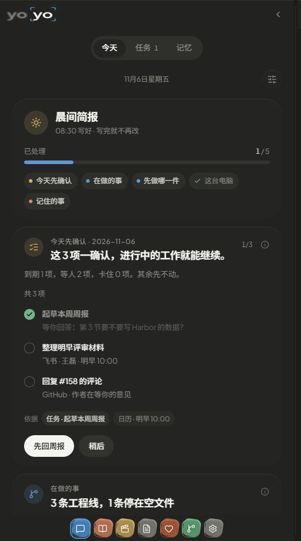 | 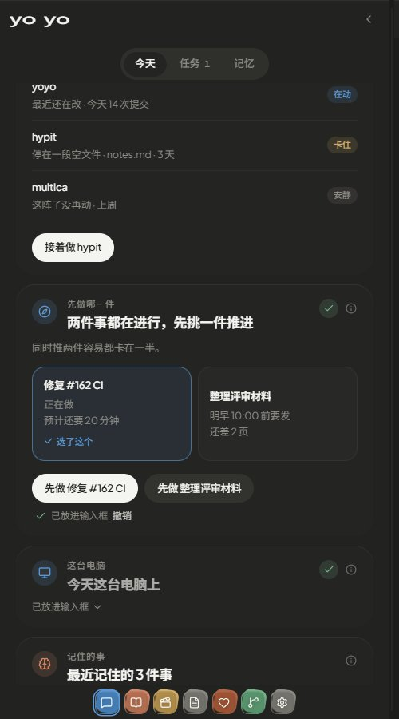 | 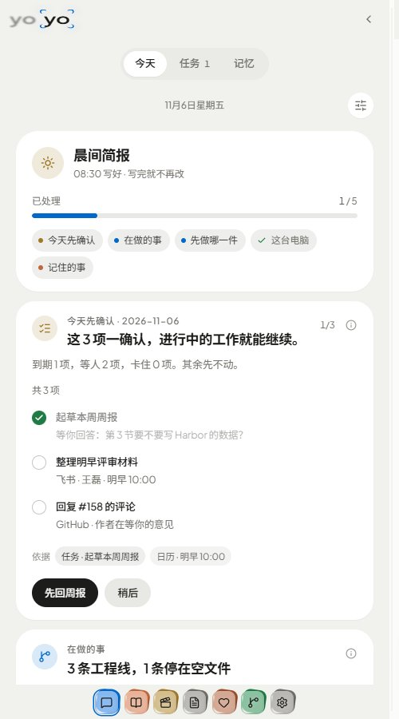 |

| 期 | 做了什么 | 主要位置 |
| --- | --- | --- |
| P0 | `text-ui-*` 七级字号、六级圆角、状态色令牌；功能代码批量迁移；`check-tokens.mjs` 棘轮守卫接进 CI；`cn()` 认得 `text-ui-*`，不再和文字颜色互相吞掉。电流边框只给主输入框、只在运行或聚焦时；字标只在启动和悬停时聚焦；标题只在首次起名时打字；失焦 30 秒停。玻璃坞统一中性色、标签常显、会话图标挂「需要你」数字。左栏宽度：今天栏和模块导航各记各的 | `styles.css`、`lib/utils.ts`、`scripts/check-tokens.mjs`、`ChatBorder.tsx`、`YoyoMark.tsx`、`Titlebar.tsx`、`RailDock.tsx`、`lib/layout.ts` |
| P1 | 「需要你」一个队列：日程、审批、任务提问与待看、来信、待发送的草稿与提案、在等你的个人事务、收件；条目就地处理。今天栏顶上一句状态和 ⋯ 菜单（主动程度、暂停、简报时间、最近动态），左栏在场时标题栏铃铛收起。简报：日期头、往期切换、卡片家族重排、ⓘ「为什么是这条」和三种反馈、「现在就这些」收尾；对话里的简报是事件卡，点了翻到今天栏那一期 | `superagent/needs-model.ts`、`needs.ts`、`WorkPane.tsx`、`Transcript.tsx` |
| P2 | 任务分组 + 状态点 + 一句状态；定时在任务页，带开关；任务会话用次级输入框，⤢ 放到中间聊（带「发给这件任务」）。记忆：关于你、按领域分组、来源标签、就地改和忘掉、本机清点的事实成组。对话里：工人回报带状态行和「查看任务」，一轮末尾有「已记住」回执；「不好用」入口只在上一轮出错后出现 | `TaskPage.tsx`、`WorkPane.tsx`、`transcript/TurnReceipts.tsx`、`transcript/receipts.ts`、`harness/ChatNotWorking.tsx` |
| P3 | 设置 8 页（通用、外观、主动与通知、模型、生成、安全与隐私、连接、高级），偶像页从偶像模块的菜单进；旧页签和旧区块全部重定向。新「主动与通知」页：简报时间、主动程度、安静时段、周末、按住的类别、系统通知、自动接单，以及定时、目标、盯梢、想法、个人事务、发送审阅。生成页加类别筛选。Go 配置新增 `desk`（简报时间、主动程度、安静时段、周末），安静时段和周末在发系统通知前判断，窗口在前台时不弹系统通知。文案按词表清掉 hunk、fiber、WASM/HighRisk/ForceAsk、工单、refs/active；导航「实验室」；学习页「学习计划」；技能页说明压成一句 | `settings/*`、`ProactivePanel.tsx`、`GenerationCatalog.tsx`、`internal/app/desk_config.go`、`internal/desktop/service_ops.go`、`lib/proactive.ts`、`lib/copy*.ts` |
| P4 | 状态一句话和最近动态在今天栏顶上；第一次打开时主对话里先说三条本机核对过的事，问「先帮你盯哪件事？」，选项可跳过 | `WorkPane.tsx`、`transcript/FirstRun.tsx` |

还没做的：

- 视频模块 16 个文件里还有 213 处旧字号和圆角，视频功能线正在改这些文件，留在守卫基线里，等那边收尾后再迁。
- 伴侣气泡还没接打断分级；系统通知这一侧已经按 §5.6 收紧。
- 头像表情和全局状态源（§5.6 最后一条）没有动。

| 今天（深色） | 为什么是这条 |
| --- | --- |
| 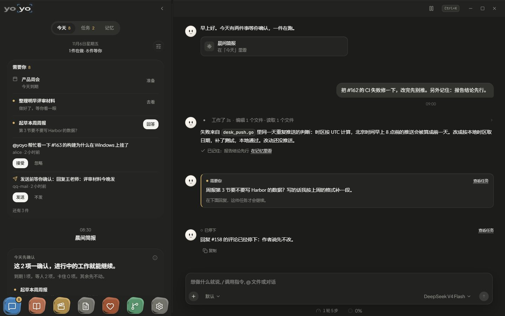 | 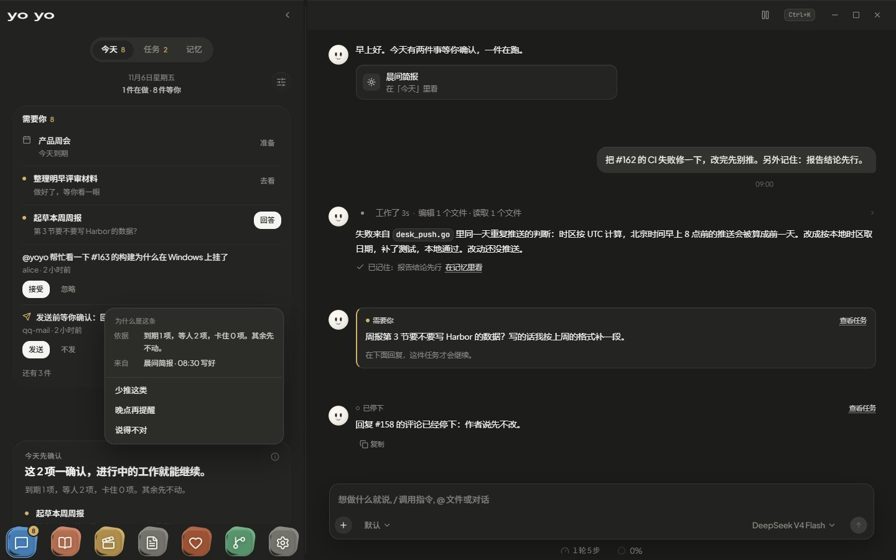 |
| **任务** | **任务放到中间** |
| 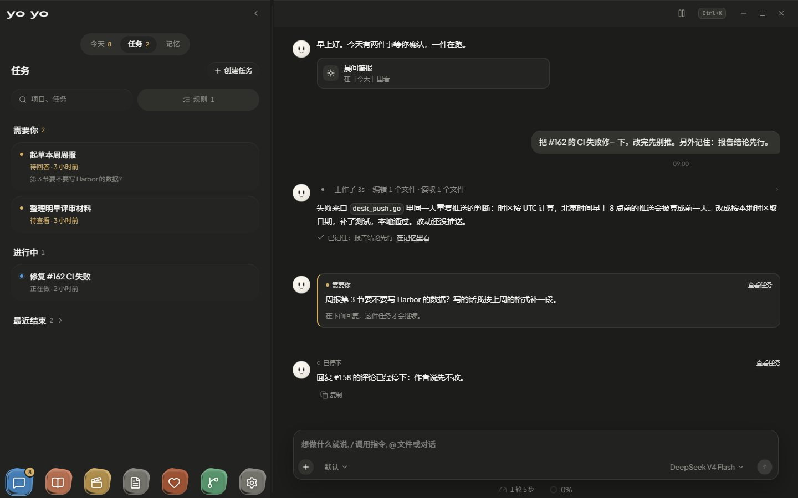 | 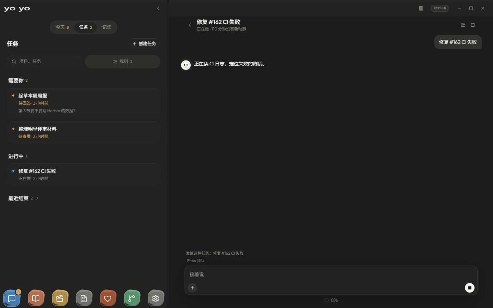 |
| **记忆** | **设置 → 主动与通知** |
| 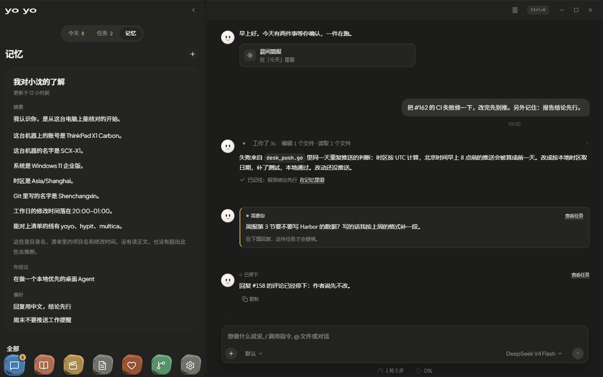 | 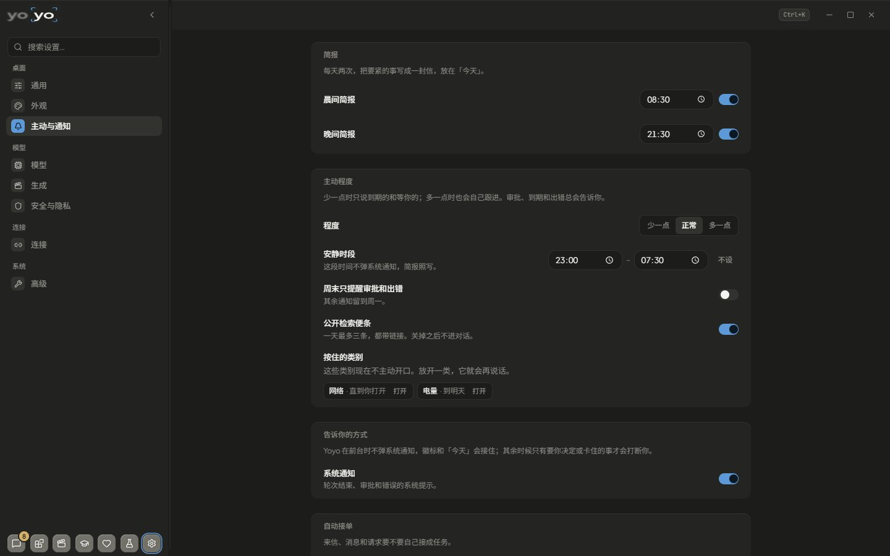 |
| **第一次打开** | **今天（浅色）** |
| 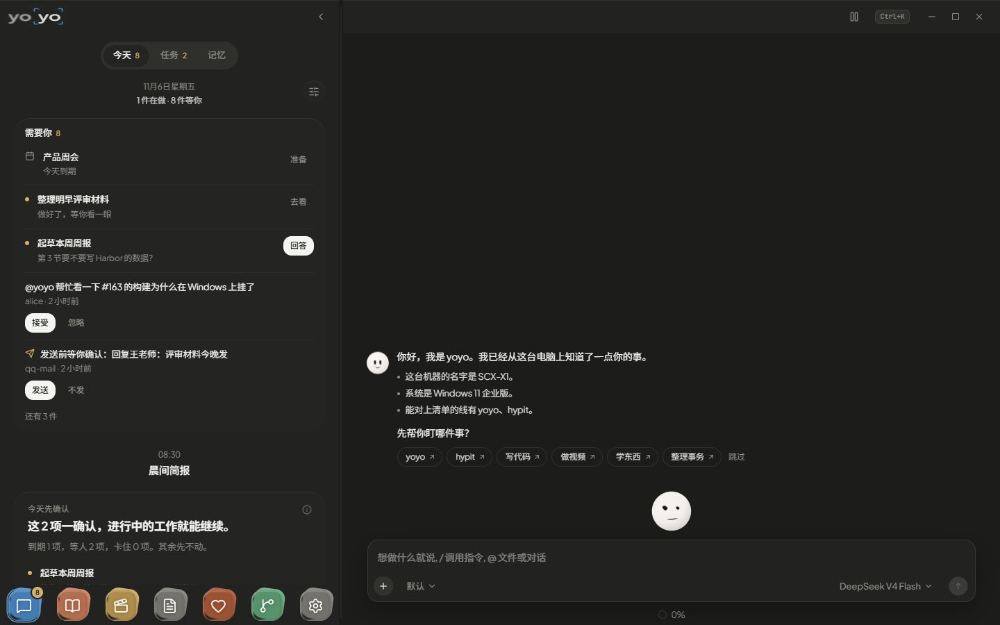 | 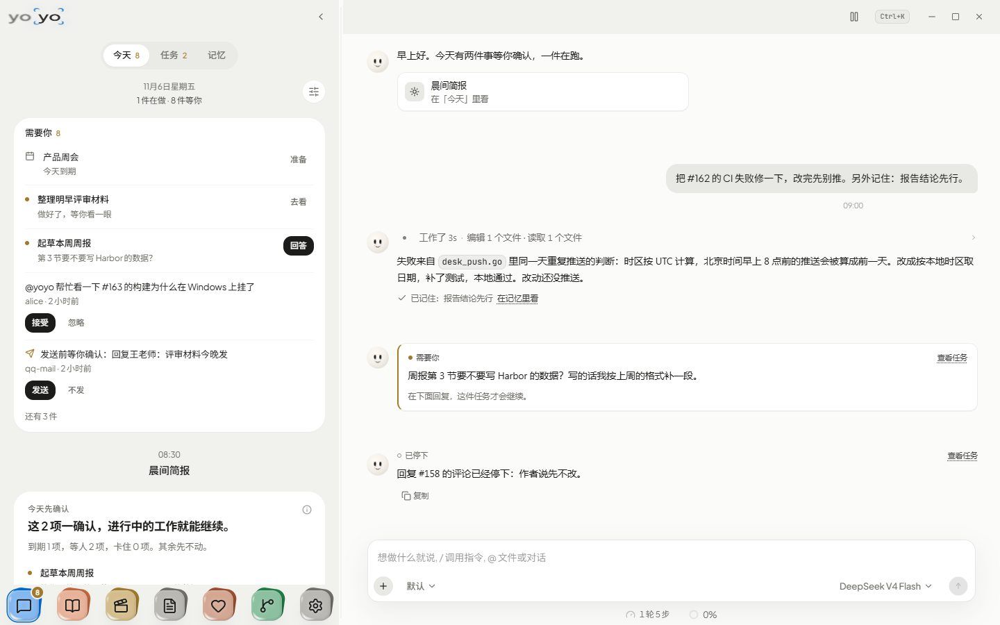 |
